# freemapper-courseplan user manual

[Deutsch](de.md) · [README](../../README.en.md)

This manual takes shape along with the first usable version. It will lead step by step from the finished OOM map
to finished courses that OE evaluates and freemapper-print prints, even without command-line experience.

Planned chapters:

1. What freemapper-courseplan does
2. Installation
3. With an AI assistant
4. Without an assistant: editor and command line
5. Setting up an event: map, discipline, classes
6. Placing and describing controls
7. Setting courses: order, bends, control numbers
8. Checking: reading findings, giving reasons for exceptions
9. Exchanging with Purple Pen
10. Handing on: IOF XML for OE, printing with freemapper-print
11. Messages and what to do

## 2. Installation: keeping the program up to date

Unpacking the archive and registering the program is described in the [README](../../README.en.md#installing). This
chapter covers what comes after: how a new version reaches you.

### The notice

A release build looks for a newer version at most once a day. It does so after `info` and when you start the editor,
waits at most three seconds and prints one line on stderr:

```
freemapper-courseplan 0.15.0 is available (you have 0.14.0). Update with: freemapper-courseplan update
```

The editor shows the same news in its status bar. The commands that work only on your files (`init`, `check`, `export`
and the others) do not check, so a script never waits for the network. A slow or failed check stays silent and is tried
again the next day. No check runs when the variable `CI` is set. A build you made yourself from source never checks and
never updates itself; `update` then tells you to use `git pull` and `cargo build --release --locked`.

### Updating

```
freemapper-courseplan update
```

shows the newest version with its release notes and download size and asks before it installs. `--yes` skips the
question (needed when no terminal is attached), `--check` only looks and ends with exit code 10 when a newer version
exists, and `--version 0.14.0` installs a given version, an older one too.

The program checks the signature of the release against a key built into it, then the checksums of the download and
of the unpacked file. It starts the new file with `--version` before it swaps anything in. Nothing is installed when
one of these checks fails. The new version takes the place of the old one under the same path, so the registration with
your AI assistant stays valid. A running MCP server keeps the old version until the assistant restarts it.

The program folder must be writable for you. The program never asks for administrator rights. If it cannot write there,
it says which folder and installs nothing; unpack the new archive by hand in that case.

### Going back

```
freemapper-courseplan update --rollback
```

swaps the version before the last update back in. The old file stays next to the program as
`freemapper-courseplan.previous` (on Windows `freemapper-courseplan.previous.exe`) until the next update replaces it.

### What the daily check does

`update --mode notify` (the default) only tells you. `--mode install` installs a newer version by itself after a
command that worked, and tells you. `--mode off` stops the daily check. The setting is stored in
`settings.toml` in the folder `freemapper-courseplan` of your system's configuration folder (on macOS
`~/Library/Application Support/freemapper-courseplan`). The variable `FREEMAPPER_COURSEPLAN_UPDATE` overrides it for
one run. The MCP server never installs on its own, whatever the mode: it tells the assistant, and the assistant asks
you before it calls `install_update`.

### What is sent

The program asks `github.com` and `release-assets.githubusercontent.com` for one small file (the update manifest and its
signature) and, when you install, for the program file. It sends a fixed User-Agent with the name, version and
repository of the program, for example `freemapper-courseplan/0.15.0 (+https://github.com/HenryJobst/freemapper-courseplan)`.
It sends no project data, no names and no identifier. Other hosts are refused, also when a server redirects there.

### A release that cannot install itself

A release can raise the oldest version that may install it. Then `update --check` still exits with 10 and names the
release page; unpack that archive by hand once. The same holds for the first release with the updater: versions
before it have no `update` command.

## 3. With an AI assistant

The assistant sets the courses for you. For this, freemapper-courseplan is an "MCP server", a tool that AI
assistants can use. The program has no AI of its own. The assistant calls the same editing functions as the command
line, and each call saves into your project file.

### Set it up once

- **Claude Desktop:**
  1. Open *Settings > Developer > Edit Config*.
  2. Add this to the file `claude_desktop_config.json`, with your own path (on Windows with doubled backslashes
     `\\`):

     ```json
     {
       "mcpServers": {
         "freemapper-courseplan": {
           "command": "/Users/anna/Documents/freemapper-courseplan/freemapper-courseplan",
           "args": ["mcp"]
         }
       }
     }
     ```

  3. Restart Claude Desktop.
- **Claude Code:** type `claude mcp add freemapper-courseplan -- /path/to/freemapper-courseplan mcp` in a terminal.
- **Other assistants:** any assistant with MCP support takes the same entry: the program and the argument `mcp`.

The assistant reads the tool texts in the language of your system. To fix the language, write
`"--lang", "en"` before `"mcp"` in the arguments, or set `FREEMAPPER_LANG=en` in the environment of the
program. Tool names and field names stay English in every language.

### Let the assistant set it up

The archive holds, besides the program, the READMEs, the licence, this manual and `AGENTS.md`, instructions for AI
assistants. An assistant that can run commands on your computer (such as Claude Code or Codex) downloads the
program, checks and unpacks it by the steps in that file and then works through the command line; it needs no
registration. Only an assistant that cannot run commands needs the registration described above. Tell it:

> Read AGENTS.md from github.com/HenryJobst/freemapper-courseplan and set up freemapper-courseplan.

On a Mac it removes the block on unsigned programs and tells you so. Depending on its settings it asks before each
command. Claude Desktop runs no commands; there you register the program by hand as described above.

### Set a course

The assistant does not see the map. It can ask for the extent of the map and, for a point, for the map objects
around it, each with its symbol number, its kind (point, line, area) and its distance. It knows no names such as
"south door" or "gym", and the query does not tell it where exactly an object lies. So give it positions, in map
millimetres or relative to the extent of the map, for example:

> Start an event from ~/maps/hall.omap. Put the start a quarter of the way in from the left edge, at half the
> height, and the finish 10 mm to the right of it. Add three controls spread over the map and tell me for each
> which map objects lie within 2 mm. Make a course "Short" from them for class D10, place the control numbers
> and tell me the length.

The assistant then works like this:

1. It starts the event. The project file lands next to the map, named `hall.courseplan.toml`.
2. It asks for the extent of the map, that is its smallest and largest corner in map millimetres, the scale and
   the map kind, and works out the positions from it.
3. It adds the start, the finish and the controls at these positions.
4. For each control it asks for the map objects nearby and tells you their symbol numbers and distances, such as
   "symbol 521, area, 0.4 mm". Look up what a symbol means in the symbol set of the map.
5. It adds the course, places the control numbers and reads the length and the climb.

You can also continue in a later chat. Give the assistant the path of the project file and it picks up from
there.

### What to know

- Paths are absolute or start with `~`. A relative path is refused, because the assistant does not know the
  working folder of the program.
- Every change is saved at once. If the program refuses a change, for example a point outside the map or a
  code that is taken, the file stays as it was and the assistant gets the reason.
- If the project file changed after the assistant read it, for example because you moved a control in the editor,
  the program writes nothing. The assistant gets "<file> changed on disk after it was read, so nothing was
  written. Read the project again and repeat the change" and repeats the change with the new state.
- Positions are in map millimetres at map scale, with y pointing down. Look at every control position yourself
  on the map. `check` tests distances, angles and codes against the rules (chapter 8), but not whether the
  control stands at the right feature.
- The program places control numbers only when the assistant asks for it. If the assistant then changes legs or
  the order, it has to have them placed again. A number placement set for a control or in a course stays.
- Automatic placement puts a number behind the circle, in line with the leg that leads to the control. If the
  course hardly turns, the next leg runs there, and the number goes outside, at the tip of the angle. It stands on
  a point or line symbol of the map only when no free place is left; it may cover areas. If you dislike the
  position, set it yourself.
- The number stands 0.5 to 5 mm from the circle (distance from the circle line to the number box, rule
  `wkb2026.number.gap`). Automatic placement starts at 0.5 mm and moves outward in steps of 0.5 mm before it turns
  away from the preferred direction. `check` warns when a stored gap lies outside the range, for example a number
  set by hand at 6 mm.
- When the order of a course changes, every leg that now runs to another stop loses its bends and its taped
  flag. The assistant gets a list of these legs.
- Individual and score courses can be edited (see Score courses below). `info` gives the length of individual
  courses; for a score course it gives controls, points and time limit, and `score length` measures it. Team and
  relay courses cannot be edited yet; the program says so.
- The project file is plain TOML. `freemapper-courseplan info <project>` shows what the assistant did, and `list controls|courses|specials|classes <project>` lists the details; `map extent <project>` and `map near <project> --at X,Y --radius MM` report the map. All of them take `--json`.

### Score courses

On a score course the runners visit the controls in any order within a time limit. Each control is worth points,
and every started minute over the limit costs points. These commands build such a course; `check` tests it
(section 8).

```sh
freemapper-courseplan course add hall.courseplan.toml Score45 --kind score --start S1 --finish F1 --time-limit 45
freemapper-courseplan score controls hall.courseplan.toml Score45 31,32,43,54
freemapper-courseplan score link add hall.courseplan.toml Score45 31 54
freemapper-courseplan score settings hall.courseplan.toml --value-max 5 --good-pace 4:10
freemapper-courseplan score course set hall.courseplan.toml Score45 --penalty 6
```

- The code carries the value: the second digit of a two-digit code, the last digit of a longer one. So 43 is worth
  3 points and 54 is worth 4. `score controls` reads the value from the code. A value you write after `=`, as in
  `43=3`, has to match it; if it differs, the program refuses and says to change the code. `score value` follows the
  same rule, so it only repairs a value in the file that no longer matches its code. A code that carries no value,
  such as `A1`, needs one: `A1=2`.
- Values run from 1 to the highest value of the event, 5 by default and at most 9 (`score settings --value-max`).
- Without `--penalty` the course stores no penalty and uses the default: the highest control value of the course, at
  least the highest value of the event, so a minute over never pays off. The default follows the controls.
  `score course set --penalty N` stores your own number, and `--no-penalty` goes back to the default.
- Changing a control's code (`control code`) gives it the value of the new code. A code that carries no value keeps
  the old value, and `check` reports the difference.
- A link names two controls that the runner has to visit directly one after the other, in either direction. A runner
  who does not is disqualified. A control takes at most two links, and links may not close a ring. A control with a
  link stays in the course until you remove the link (`score link remove`).
- `score settings` writes the `[score]` table of the event: value range, the paces of a good and a very good runner
  (seconds per kilometre, or `4:10`), the share of hard controls and the seed. Four distances in metres on the ground
  decide where controls stand (ADR 0072): `--value1-min` (150 m) is the least distance of a control from start and
  finish, where value 1 begins; `--min-gap` (100 m, not lower) the least distance between two controls;
  `--high-value-gap` (200 m, at least `--min-gap`) the least distance between two high-valued controls, the upper four
  tenths of the values (4 and 5 at a highest value of 5); `--max-reach` the farthest distance from the start. Without
  it the reach is automatic, a quarter of the ground the good runner covers in the time limit (900 m at 15 minutes
  and 4:10 min/km); `--auto-reach` returns to that. A distance is a whole number of metres.
- Each of these commands takes `--json` and prints what the MCP tool of the same name answers
  (`add_score_course`, `set_score_controls`, `set_control_value`, `add_score_link`, `remove_score_link`,
  `set_score_settings`, `set_score_course_details`). The editor runs the same operations, and undo takes each back.
- Bends, legs, control numbers and `course controls` belong to individual courses; a score course refuses them.
  Classes, print scale, `course rename` and `course remove` work on both. Team and relay courses cannot be edited yet.
- IOF XML export writes score courses too (see Export below). The Purple Pen export still skips them and says so. The editor draws score courses and has a Score
  panel (see "The Score panel" in the editor chapter).

#### Lists and evaluation sheet

```sh
freemapper-courseplan export hall.courseplan.toml --course Score45 --csv score45.csv --sheet score45.md
```

`--csv` writes one row per control: `code,value,x_mm,y_mm`, ordered by code, with positions in map millimetres at map scale (y points down) and a dot as decimal separator. `--sheet` writes the evaluation sheet as Markdown, a text that prints well as it is: the time limit, the penalty per started minute (the stored one or the default), the rule that the faster runner wins on equal points, the mandatory links with the rule that a runner who does not run a link directly is disqualified, and a table of the controls with their values. Both need `--course` and refuse a course that is not a score course. An existing file is replaced. The tools are `export_score_csv` and `export_score_sheet`, with `project`, `course` and `path` (ending in `.csv` or `.md`). The decisions are in ADR 0070.

#### Suggestions, draft and length

These three commands read the map and search routes on a raster of its symbols (no elevation), so each takes a few
seconds on a large map. The start and the finish must lie outside buildings and blocked areas; if one does not, the
program says the start or finish cannot be reached.

```sh
freemapper-courseplan score suggest hall.courseplan.toml --limit 30
freemapper-courseplan score draft hall.courseplan.toml Score45 --time-limit 45
freemapper-courseplan score draft hall.courseplan.toml Score45 --time-limit 45 --apply
freemapper-courseplan score length hall.courseplan.toml Score45
```

- `score suggest` lists control sites, best route choice first, each with its position, the symbol code of the map
  feature, route choice and difficulty from 0 to 1, the time from the start for the good runner and the value it
  would get. It writes nothing. `--limit` sets the number (60 by default, at most 200), `--min-distance` the
  smallest distance in map millimetres (by default the setting `min_gap_m`, 100 m on the ground). Sites closer than
  `value1_min_m` to the start or finish are dropped, and with `--course` so are sites beyond the reach from the start.
  `score draft` also keeps the gap between high-valued controls; `check` warns when a course falls below it or below
  the minimum gap. `--course NAME` takes the start and
  finish of that score course (`--start` and `--finish` still win); without it the first start and finish of the event count.
  Sites in out-of-bounds and dangerous areas, and within 4 m of a forbidden route, are excluded. With `--json`
  and over MCP each candidate also has a free `code` that carries its value. It is `null` when no free code is left:
  only the best-ranked candidates get one.
- `score draft` picks controls from these sites and gives them values and codes, so that the good runner scores
  87 to 93 percent of all points by default within the limit and the very good runner takes every control and
  finishes after 95 to 100 percent of it by default. Both bands are settings of the event. Without `--apply` it only prints the draft. With
  `--apply` it adds the controls and creates the score course, or replaces the controls of an existing score course
  and removes the controls that only it used. A course of another kind is refused. The editor can undo the change.
- `--link "X,Y;X,Y"` makes two positions a mandatory link; each must be the position of a candidate from `score
  suggest`, run with a `--limit` of at least 60, the pool the draft uses. Repeat the option for more links.
- When no draft meets both bands, the command exits with 1. It names each missed band with the size of the miss, and
  one hint: a longer or shorter limit, more suitable sites, free codes (the control count is capped by the code space: raise the highest value with `score settings --value-max`, 9 at most, or free codes on the map), a faster good runner, or that these inputs cannot work.
- `score length` analyses a course that exists, for example after you moved a control, and reports the same bands and
  misses. It never changes the course.
- The same answers come from the tools `score_suggest`, `score_draft` and `score_length`; `--json` prints them.
  The draft is the same on every run for the same project.

## 4. The editor

The editor shows the event in the browser. You can place, move and delete controls, build courses and categories,
bend and tape legs, place control numbers, draw special objects, choose control description symbols and take each step back.
The map under the courses is the real one. The editor runs the check as you work and shows its findings. Export,
import and sync with Purple Pen are in the Event menu.

### Starting it

```sh
freemapper-courseplan edit rummelsburg-sprint.courseplan.toml
```

The command loads the project, opens the browser and prints the address on a single line, such as
`http://127.0.0.1:47123/3f9c…/`. If the project file is broken, it names the file and exits with code 1 without
printing anything. It runs until you press Ctrl+C or choose "Close editor" in the "Event" menu. Both end it with
exit code 0.

- `--port N` picks the port. Without it the program takes a free one. If the port is taken, the program says so and
  exits with code 1.
- `--no-browser` does not open the browser. You open the printed address yourself. If the browser cannot be started,
  the program prints a hint and keeps running.
- The page speaks the program's language (`--lang en`, `FREEMAPPER_LANG` or the system language setting). The page
  has no language switch; to change the language, restart the editor.

One editor belongs to one project. To open a second project, start a second editor.

### What the page shows

- On the left is the tree of the event with the groups Courses, Categories, Controls and Special objects. "All
  controls" shows every control with its code.
- In the centre is the map. When you select a course, the editor draws its circles, start triangle, finish, legs and
  control numbers on top. A number box with a dashed outline was placed automatically; the project stores no position
  for it yet.
- On the right are the properties of the selection, for example name, length and climb of a course, or code, kind,
  position and description of a control. For a control the list also names the map objects within 3 mm. Below them
  are the findings of the selection.
- The status bar at the bottom names the map, the scale, the map kind and the cursor position in map millimetres.
  Messages appear there too.

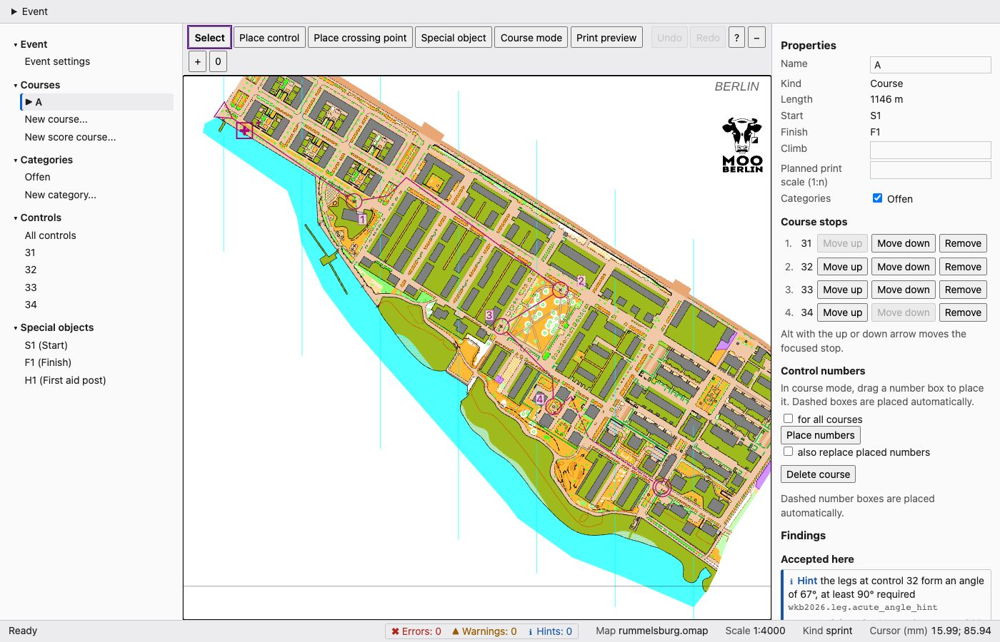

*The editor with course A (five controls, 1226 m) on the sprint map Rummelsburger Bucht. English interface. Map: Remo Madella, MOO Challenge Berlin 2025, see examples/rummelsburger-bucht/ATTRIBUTION.txt.*

### The map

The map is drawn by the renderer that freemapper-print uses too (freemapper-render in freemapper-core v0.14.1). The
editor shows it as SVG, so lines and text stay sharp at any zoom. Circles, legs and numbers lie on top and sit at
the map position they belong to. The status bar and the properties give positions in map millimetres, not page
millimetres.

The page asks for the part of the map you see, plus a margin, 150 ms after the view stops moving. While you drag the
view, nothing is requested; the new section appears when you let go. When the map file changes, the editor draws it
again.

Three limits can show up in the status bar:

- **The map is larger than one A3 sheet at map scale.** The renderer can only draw a page of A4 or A3. The editor
  draws the middle part and says so. Courses and controls outside that part stay visible on the overlay, but you
  see no map beneath them. Core would need a free page size to lift this limit.
- **The map is very detailed.** The renderer leaves out objects once its budget for the page is spent, shortens
  some and drops some area patterns. The editor says the map area is incomplete. Courses are not affected. Hidden
  symbols stay silent.
- **The zoom is too high.** If the section you look at would need an image of more than 100 000 px on a side, the
  server refuses to draw it, the status bar says so and the overlay stays. Zoom out or move to a smaller section.
  The page itself limits the image to 6 000 px on a side, so you will meet this message only after a hand-made
  request.

The "Print preview" button (key P) shows the selected course the way freemapper-print draws it. The server hands the
course to the shared renderer, which paints the purple layers into the map image; the editor's own overlay is hidden.
Editing is off while the preview is on (the tree, the properties, undo and the keys are switched off), and a press on the map only pans. The button works once you have selected a
course. A test compares the editor's circles, legs, marked legs, crossing points and number boxes with the renderer's to 0.01 mm. The decisions are
in ADR 0046, 0056 and 0057.

### Controls

The toolbar has the tools "Select", "Place control", "Place crossing point" and "Special object". Every change is
saved at once, through the same operations as the command line and the AI assistant, so the same checks apply. If
the program refuses a change, for example a position outside the map, the file stays as it was and a message says
why.

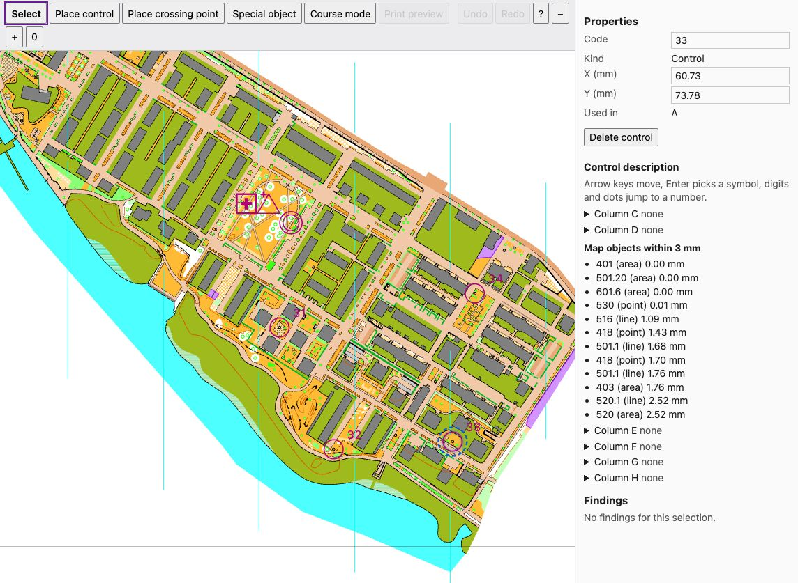

*Control 33 selected. The properties show code, kind, position and the courses that use it, then the control description and the map objects within 3 mm. Map: Remo Madella, MOO Challenge Berlin 2025, see examples/rummelsburger-bucht/ATTRIBUTION.txt.*

- **Select.** With the "Select" tool, click a control in the map or in the tree. A click selects the control whose
  centre is nearest to the pointer, as long as the pointer is within the circle's radius plus the line width. The
  properties on the right show it.
- **Place.** Choose "Place control" and click on the map. The editor adds a control at that point.
- **Place a crossing point.** "Place crossing point" works the same way but adds a control of the kind "Crossing
  point". It takes the next free code, shares the numbering with the other controls and appears in the tree with
  "(Crossing point)". On the map it is drawn as two arcs without a circle. Its properties show code, kind and
  position, but no control description, since a crossing point has none. To add it to a course, use course mode
  like for any control.
- **Move.** Drag a circle, or type a new value into the fields X (mm) and Y (mm) in the properties. You may write
  a decimal comma or a decimal point, `12,5` or `12.5`. Anything else marks the field and shows a hint. While you
  drag, only the circle moves. Legs and numbers follow when you let go. Esc cancels the drag, and the control
  stays where it was.
- **Nudge.** With a control selected, the arrow keys move it by 0.1 mm, with Shift by 1 mm. The editor saves once
  when you release the key, so holding a key makes a single undo step. Without a selection, the arrow keys move the
  view.
- **Change the code.** Edit the "Code" field in the properties. The courses and accepted findings that name the
  control follow. The editor refuses a code that is empty, has spaces at its ends, is longer than 64 characters or
  belongs to another control. On the command line the same is `freemapper-courseplan control code
  hall.courseplan.toml 31 K7` (see "Changing a code or a name on the command line" below).
- **Delete.** Press Delete or Backspace while the focus is on the map or the tree, or use "Delete control" in the
  properties. In a field or on a button the keys do nothing. A control that no course visits is deleted at once;
  undo takes it back. If courses visit the control, a dialog lists them and asks. The focus is on "Cancel".
  "Delete" removes the control and takes it out of those courses. A stray Backspace on a selected, unused control
  therefore deletes it without a question; undo brings it back.

### Courses and categories

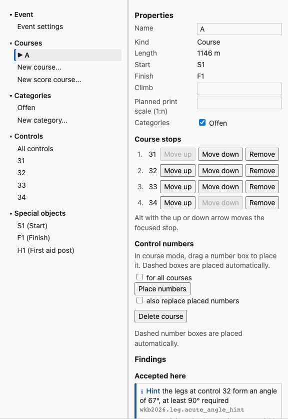

*Course A selected. Left the tree with courses, categories, controls and special objects, right the properties of the course with the stops with "Move up", "Move down" and "Remove", the category box and the control numbers. Map: Remo Madella, MOO Challenge Berlin 2025, see examples/rummelsburger-bucht/ATTRIBUTION.txt.*

- **New course.** Choose "New course..." under "Courses" in the tree and type a name. The course gets the start and
  the finish of the event. If the event has not exactly one start and one finish, the editor says so and adds
  nothing. A name that is taken, empty or longer than 200 characters is refused in the dialog.
- **Rename a course.** Edit the "Name" field in the properties of the course. Special objects and accepted findings
  that name the course follow. On the command line use `freemapper-courseplan course rename hall.courseplan.toml A
  Long`.
- **Course mode.** Select a course, then choose "Course mode". The controls the course does not visit appear in
  grey. A click on a control adds it before the finish. To insert a control inside the course, first click the leg
  where it belongs, then the control. The chosen leg turns thick and blue, and the status bar says which one it is.
  Esc drops the chosen leg; a second Esc leaves course mode. Course mode has no key.
- **Stops.** The properties of a course list its stops. The buttons "Move up", "Move down" and "Remove" change the
  order. With the focus on a row, Alt+Up and Alt+Down move the stop. Each change is one step for undo and saves the
  whole list at once. If a change sends a leg to another stop, that leg loses its bends and tape. The status bar names
  those legs.
- **Course details.** Climb and planned print scale are fields in the properties; an empty field removes the value.
  The check boxes assign the course to categories.
- **Categories.** "New category..." adds one. Its properties hold the rule category and the expected starters; an
  empty field removes the value. "Delete category" removes it. The editor refuses this while a course still uses
  it, and says so above the map.
- **Event.** "Event settings" in the tree shows the discipline, which you cannot change here, the rule profile with
  its overlays, both as lists of the profiles the program knows, and the start window in minutes. An empty start
  window removes it.

### Legs and bends

A leg is the straight line from control to control until you bend it. Click it with the "Select" tool to choose it.

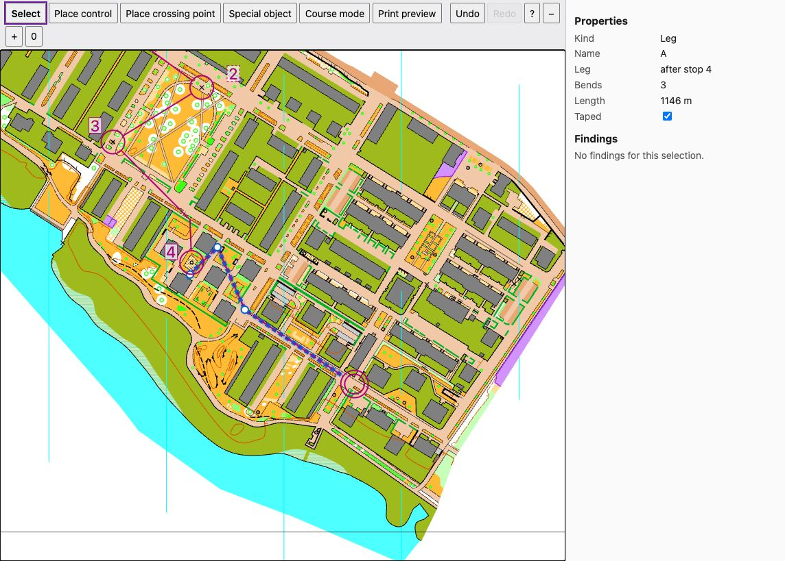

*A leg chosen with the "Select" tool. The leg from control 32 to control 33 has three bends (the white dots); the properties show their number and the box "Taped". The dashed leg from control 35 to the finish is taped and has one bend. I set these bends only for the picture: legs are straight by default, and the course of the example has no bend. Map: Remo Madella, MOO Challenge Berlin 2025, see examples/rummelsburger-bucht/ATTRIBUTION.txt.*

- **Add a bend.** Drag the line of the chosen leg. A bend appears where you let go.
- **Move or delete a bend.** Drag a bend to move it. A click on a bend chooses it, and Delete removes it.
- **Tape a leg.** The "Taped" check box in the properties of the leg marks it as a taped leg.

Each gesture is one step for undo, and the course length in the properties changes with it. A leg that a change to
the stops sends to another stop loses its bends and tape.

### The Score panel

A score course has no running order, so the editor draws its controls, start and finish, and each mandatory link as a
dashed line between its two controls. Select the course in the tree to open the Score panel in the properties.

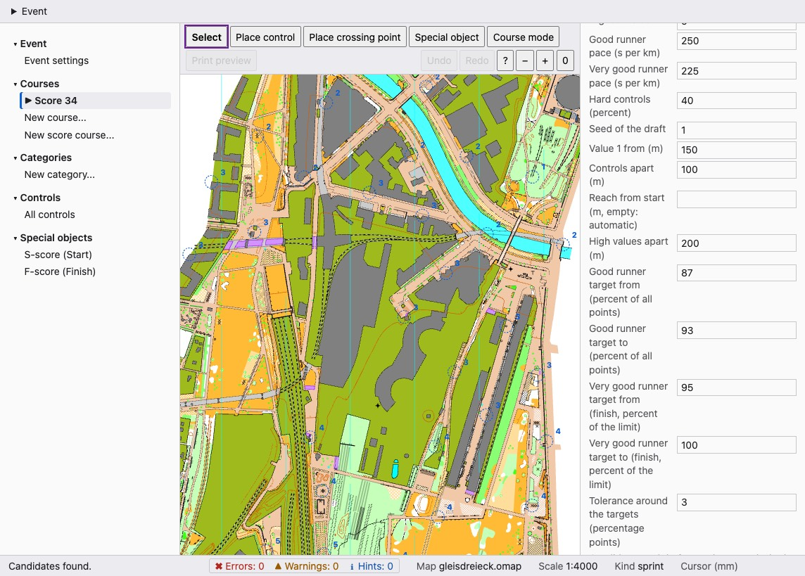

*A new score course "Score 33" with a limit of 33 minutes, after "Suggest controls". Each candidate is a dashed circle with its value. The panel on the right holds the buttons and the settings. Map: Remo Madella, MOO Challenge Berlin 2025, see examples/gleisdreieck/ATTRIBUTION.txt.*

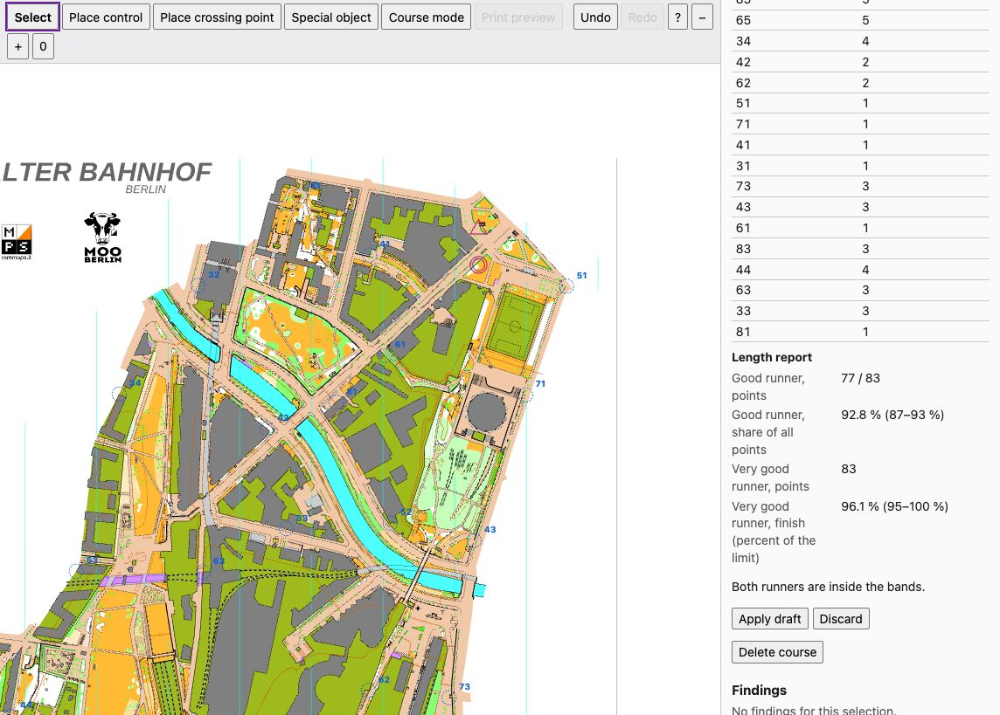

*The result of "Draft course". The draft controls show their codes. The panel lists the length report, and both runners are inside their bands. Nothing is written until you choose "Apply draft". Map: Remo Madella, MOO Challenge Berlin 2025, see examples/gleisdreieck/ATTRIBUTION.txt.*

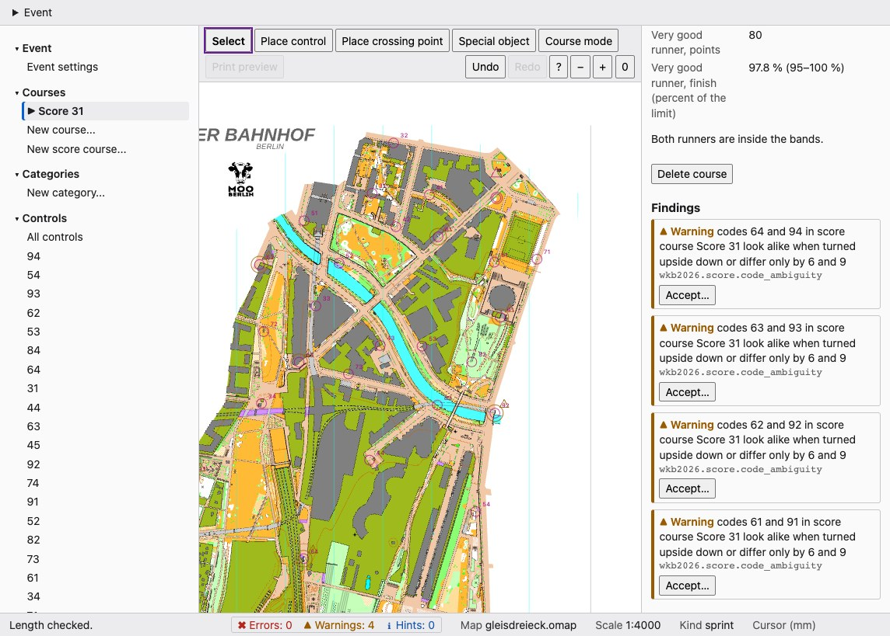

*After "Apply draft" and "Check length". The course has 27 controls worth 83 points. The finding at the bottom is a warning that codes 65 and 95 look alike when turned upside down. Map: Remo Madella, MOO Challenge Berlin 2025, see examples/gleisdreieck/ATTRIBUTION.txt.*

- **Fields.** Time limit, penalty per minute (the box "Default penalty" goes back to the default) and the shared
  settings: highest value, the paces, the share of hard controls, the seed and the four distances (value 1 from, controls apart, reach from the start,
  high values apart). The two bands are shown, not edited.
  "New score course..." in the tree makes a course with a 45 minute limit; the event needs one start and one finish.
- **Suggest controls.** Shows ranked candidates as dashed circles with their value, and as a table. "Accept" adds
  one to the course, as two steps for undo. A candidate without a free code cannot be accepted.
- **Draft course.** Computes a draft for the time limit and shows its controls, links and the length report with
  both runner profiles. Nothing changes until you choose "Apply draft". It writes exactly the draft on the screen,
  without a new search, and replaces the controls and the links of this course, as one step for undo. A change of
  the time limit or of a setting discards the draft. "Check length" reports the course as it is.
- **While it runs.** A suggestion or draft takes seconds. The buttons stay disabled, the panel says that it is
  working, and the editor still notices changes to the file. Candidates and drafts are not saved. If another program
  changes the project meanwhile, they are discarded and the panel says so.
- Course mode and the print preview are for individual courses only.

### Control numbers

The number box of a control sits beside its circle. A dashed outline means the program placed it automatically and
the project stores no position for it yet.

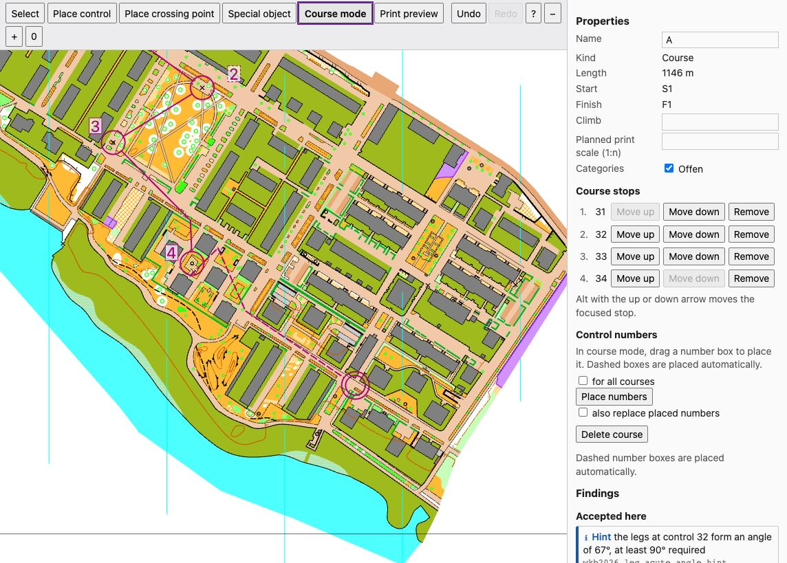

*Course mode. The numbers sit beside their circles. The box 2 has a dashed outline, so the program placed it and the project stores no position for it. The boxes 1, 3, 4 and 5 have a placed position. Map: Remo Madella, MOO Challenge Berlin 2025, see examples/rummelsburger-bucht/ATTRIBUTION.txt.*

- **Drag.** In course mode, drag a number box to another place. On release the editor turns the place into a
  direction and a gap from the circle and stores both for this course.
- **For all courses.** With "for all courses" ticked, the placement is stored on the control and applies to every
  course that uses it. A placement the course already has for itself comes before the one on the control. The box
  then snaps back, and the status bar says so.
- **Place numbers.** "Place numbers" places the numbers of the course automatically and leaves placed numbers alone.
  With "also replace placed numbers" everything is computed again, except the numbers set on the control for all
  courses.

One drag is one step for undo. A gap outside the rule range gets a warning sign at the number box (see "Findings").

### Control descriptions

Select a control. Its properties list the columns C to H, each folded and showing the current symbol. Open a column
to see its symbols as a grid of icons, each with its number and text in the language of the program. The map objects
within 3 mm of the control are listed below column D.

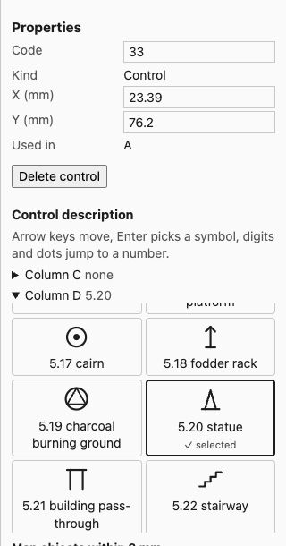

*Control 33 with column D open. Each symbol shows its number and name; 5.20 statue is picked. Column C stays folded and shows its current value. Map: Remo Madella, MOO Challenge Berlin 2025, see examples/rummelsburger-bucht/ATTRIBUTION.txt.*

- **Pick.** Click a symbol, or move with the arrow keys (Home and End jump to the first and last) and press Enter.
  Typing a number such as `1.3` jumps to it. The symbol in use is marked, and the focus stays on the pick.
- **What a column offers.** Column C has the symbols 0.1 to 0.5 for which of several similar features is meant, with
  the compass directions 0.1N to 0.2NW; the instruction rows are not offered there.
  Column D has 1.1 to 6.2, column E has the symbols of column D and 8.1 to 8.11, column F has 10.1,
  10.2 and 11.1 (the number symbols 9.1 to 9.4 are not offered, because the project file holds no value for them), column G has the 12.x symbols, and column H has 13.1 to 13.3.
- **Directions.** A symbol with a direction exists only with one: choose `12.1N`, `12.1NE` and so on, there is no
  plain `12.1`.
- **A symbol the column does not list.** If the control holds one (an old or hand-written one), it appears at the top
  as "current value" and stays until you pick something else.
- **No symbol.** The entry "No symbol" empties the column.
- **Undo.** Each pick, and each emptied column, is one step for undo.

The list comes from freemapper-core, so every symbol you can pick can also be written to a `.ppen` file (ADR 0051).

### Special objects

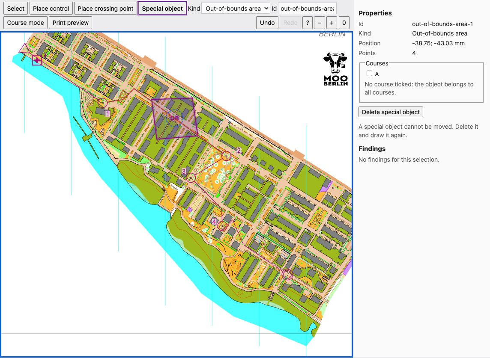

*The "Special object" tool with the kind "Out-of-bounds area" and its id in the toolbar. The finished area (four points) is selected. The properties show id, kind, position, points and the courses it belongs to. Map: Remo Madella, MOO Challenge Berlin 2025, see examples/rummelsburger-bucht/ATTRIBUTION.txt.*

- **Draw.** Choose "Special object", pick a kind (start, finish, first aid post, water point, marked route,
  forbidden route, out-of-bounds area, dangerous area) and check the id in the toolbar. It is proposed as
  `<kind>-<n>` and you may change it. A start, finish, first aid post or water point is placed by one click. A line
  or an area is drawn by clicking its points and finished with Enter or a double click. Esc cancels, Delete takes
  back the last point, and a dashed preview with dots shows the drawing. An area needs three points, a marked route
  two. A forbidden route may have a single point, which is drawn as a cross. Each object is one step for undo.
- **Signs on the map.** M marked route, a cross forbidden route, OB out-of-bounds area, ! dangerous area, plus first
  aid, W water.
- **Assign to courses.** In the properties of a selected object, tick the courses it belongs to. With none ticked it
  belongs to all courses. Start and finish have no course list.
- **Delete.** "Delete special object" or the Delete key removes the object; undo brings it back.
- **No move.** The editor cannot move a special object. Delete it and draw it again (ADR 0049).

### Findings

Half a second after each change the editor runs the same check as `check` and shows the result.

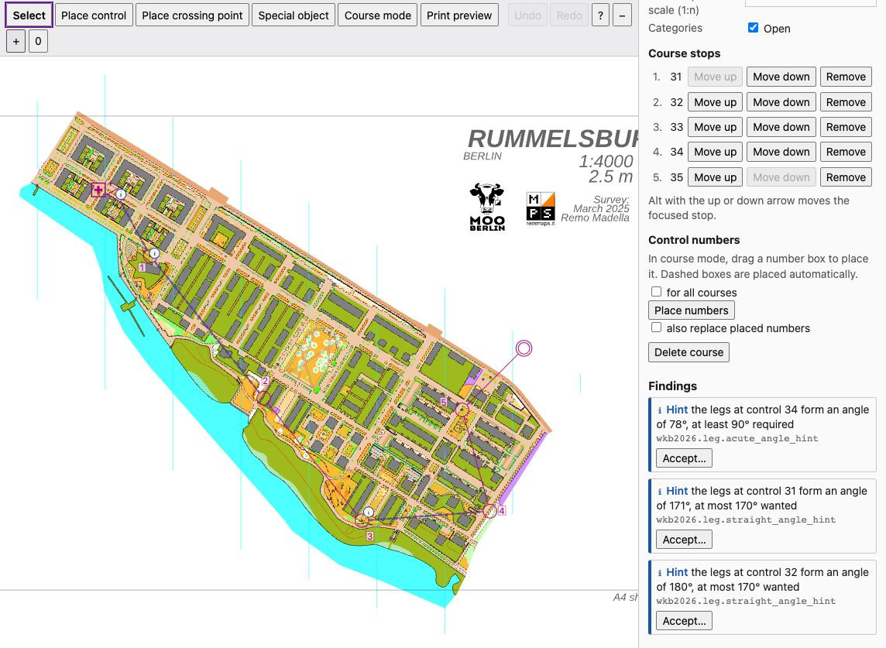

*The findings of course A. The three hints are about angles: two controls where the course runs almost straight on and one acute angle. I moved two controls of the example course for this picture; the example course itself has no finding. Each finding has "Accept...", and a marker sits on each leg it concerns. Map: Remo Madella, MOO Challenge Berlin 2025, see examples/rummelsburger-bucht/ATTRIBUTION.txt.*

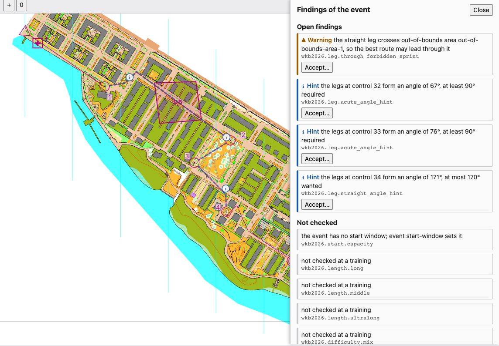

*The findings drawer, opened by a click on the counts in the status bar. It lists the open findings of the whole event and, under "Not checked", the rules that did not run, each with its reason. Map: Remo Madella, MOO Challenge Berlin 2025, see examples/rummelsburger-bucht/ATTRIBUTION.txt.*

- The status bar counts errors, warnings and hints of the whole event. Each count has a sign (cross, triangle, "i") as
  well as a colour. A click on the counts opens the drawer: all open findings, the accepted ones with their notes, and
  under "Not checked" the rules that did not run, with the reason.
- The panel on the right lists the findings of the selected control, leg or course. A click on a finding selects its
  place and fits the map to it.
- On the map a ring marks each control with a finding and a thick dashed line each leg. A warning sign at the number
  box means a gap outside the rule range. The signs differ by severity in shape too.
- "Accept..." asks for a note of up to 200 characters and stores the exception in the project file. The finding then
  moves to "Accepted" with its note, and "Remove acceptance" brings it back. Both are one step for undo.

### Export and import

The Event menu has four entries. The browser never names a file; the editor writes only the project's own linked
Purple Pen file.

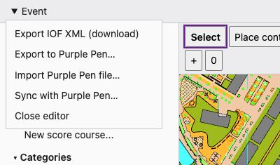

*The "Event" menu. Its entries export IOF XML, export to Purple Pen, import a Purple Pen file, sync with Purple Pen and close the editor.*

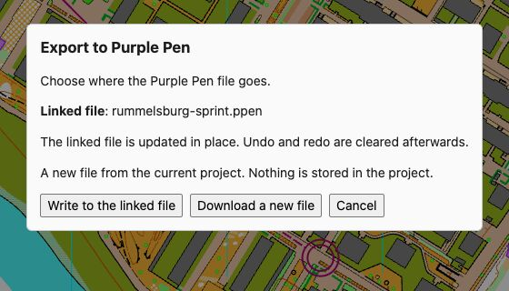

*The dialog "Export to Purple Pen". It names the linked file `rummelsburg-sprint.ppen` and offers "Write to the linked file" or "Download a new file". Map: Remo Madella, MOO Challenge Berlin 2025, see examples/rummelsburger-bucht/ATTRIBUTION.txt.*

- **Export IOF XML (download).** The browser saves the IOF XML of the individual and score courses, named after the project
  file. A dialog lists courses that were left out (team and relay courses) and says so when the map has no
  georeferencing.
- **Export to Purple Pen...** "Write to the linked file" updates the file `sources.ppen` names, by the rules of
  `export --ppen`: it patches what the project changed and stores new Purple Pen ids in the project. Without a link
  the button is off. The command `export --ppen FILE` creates a file and links it. "Download a new file" saves a new
  `.ppen`; nothing is stored in the project. A dialog lists the notes.
- **Import Purple Pen file...** You choose a `.ppen` from your computer. A project that already has controls,
  courses or special objects is refused unless you tick "Replace", which replaces all three. The import does not
  change the link `sources.ppen`: the editor never learns where the file lives. A dialog lists the notes. Files
  over 50 MiB are refused (ADR 0053).
- **Sync with Purple Pen...** Uses the file `sources.ppen` names, like `sync`. Close the event in Purple Pen first;
  a warning says so and can be silenced for the session. The panel lists the changes and the conflicts. Each
  conflict has "Keep courseplan" and "Take Purple Pen"; "All courseplan" and "All Purple Pen" sync at once with that
  side everywhere. "Sync" is on when no conflict is open (ADR 0054).

Writing to the linked file and importing clear the undo history, and so does a sync that wrote files, because they change more than one step. A sync that wrote nothing keeps it.

### Undo and redo

The toolbar buttons "Undo" and "Redo" and the keys Ctrl/Cmd+Z and Ctrl/Cmd+Shift+Z (or Ctrl+Y) walk through the
steps of this editor session. One placing, one drop, one field change, one delete and one series of nudges is a
step each. The status bar reports "Undone" or "Redone".

- The editor keeps the last 100 steps, as long as their file copies together stay under 64 MiB; the oldest steps go
  first. They are lost when you close the editor.
- Undo and redo act on the state you see. If a second browser tab shows an older state than the file, they refuse
  and the tab loads the current state; they never revert what the other tab did without you seeing it.
- Undo restores the file as it was before the step, comments and layout included. That also takes back whatever
  else the step changed in the file, for example the removal of a control from a course.
- If another program changed the file after your last step, undo and redo refuse. The status bar says "The project
  file changed outside the editor, so undo and redo are no longer possible. Nothing was changed." and the history
  is empty from then on. The editor notices this at your next undo or redo, not at the moment of the outside change.

### Shortcuts

Press `?` or the "Keyboard shortcuts" button for this list in the page. A key typed into a field is never taken as
a shortcut.

| Keys | Effect |
| --- | --- |
| Ctrl/Cmd+Z | Undo |
| Ctrl/Cmd+Shift+Z, Ctrl+Y | Redo |
| Delete, Backspace | Delete the selected control, bend or special object; while drawing, the last point |
| Esc | Cancel a drag or a drawing, drop the chosen leg, leave course mode or go back to the select tool |
| Alt+Up, Alt+Down | Move the focused stop of a course |
| Enter | Finish the line or area being drawn |
| V | Select tool |
| C | Place-control tool |
| S | Special-object tool |
| Arrow keys | Move the selected control by 0.1 mm (without a selection: move the view) |
| Shift+arrow keys | Move the selected control by 1 mm |
| `+`, `-` | Zoom in, zoom out (Ctrl or Cmd with these keys still zooms the browser) |
| `0` | Fit the map to the window |
| `?` | Show the list |

### Mouse and tree

- In the tree, the arrow keys, Home and End move between entries and Enter selects.
- With the mouse you move the view by dragging on empty space and zoom with the wheel.
- Tab moves from the tree to the map, to the properties and to the menu.

### Changing a code or a name on the command line

```sh
freemapper-courseplan control code hall.courseplan.toml 31 K7
freemapper-courseplan course rename hall.courseplan.toml A Long
```

`control code` gives control 31 the code K7. `course rename` renames course A to Long. Courses, special objects and
accepted findings that name the control or course follow. A code or name that is taken, empty, padded with spaces
or too long is refused with a message, and the file stays as it was. The AI assistant has the tools
`set_control_code` and `rename_course` for the same.

### Changed outside the editor

If another program changes the project file, for example `freemapper-courseplan control move` in a terminal or the AI
assistant, the page reloads it after about two seconds and says so in the status bar. A tab in the background does
not ask again until you open it. If the map changes, the page reloads it. If the linked `.ppen` changes, the status
bar shows a note.

If you make a change in the page while the file is out of date, say between two polls, the editor refuses it. It
loads the current state, shows the banner "The project file changed outside the editor. The editor loaded the
current state; nothing was changed." at the bottom of the map and writes the same text in the status bar. Look at
what the other program did and make your change again if you still want it. "Dismiss" closes the banner.

If the project file does not load, for example because someone left it half edited, every change in the editor is
refused with the load error until the file is readable again.

### Commands that find the file changed

The editor is not the only program that saves the project file. Every command that changes it checks, right before
it saves, whether the file is still the one it read. If it is not, for example because the editor saved a move
while the command ran, the command writes nothing, prints

```
rummelsburg-sprint.courseplan.toml changed since it was read; nothing was written
```

and exits with code 1. Run the command again; it then reads the new state. The check counts any change in the file,
also a save from a text editor that changed nothing in the event. The AI assistant gets the same refusal in words
of its own (chapter 3). `sync` writes the `.ppen` before the project file. If the project file changes in between,
`sync` reports a partial write, and running it again finishes the job (chapter 9).

### Privacy and security

- The server listens on `127.0.0.1` only. Other computers on the network cannot reach it.
- The address contains a random access token (32 hex digits). Anyone who knows the full address can look at the event
  on your computer. Do not pass the address on.
- The token also shows in the process list while the program hands it to the browser. On a computer that several
  people share, another user can read it there. Start the editor with `--no-browser` on such a machine and open the
  address yourself, or work on your own computer.
- The page loads nothing from the network. The server reads only the project file, the map and the linked `.ppen`.
  It accepts no file names from the browser.
- The server also checks the origin and content type of requests that write, so a foreign web page in the same
  browser cannot trigger anything. The editor changes only the project file, and only through the operations of the
MCP tools. The address of an operation names no file.

The decisions behind this are in ADR 0042, 0045 and 0046.

## 8. Checking: reading findings, giving reasons for exceptions

`check` holds every individual and score course against the rules the event is meant to follow and tells you what stands
out. It changes nothing in the project file. You decide whether to change the course or to give a reason for the
finding as an intended exception.

```sh
freemapper-courseplan check hall.courseplan.toml
freemapper-courseplan check hall.courseplan.toml --all
```

`check` tests angles in both directions. It reports an acute angle as a hint below 90° and as a warning below
45°. If the course runs almost straight at a control, with an angle above 170° between the legs, it gives a hint
(`wkb2026.leg.straight_angle_hint`). The control then hardly changes the running direction, and there is no room
for the number behind the circle.

The program does not check team and relay courses yet. For each of them it reports once that it was not
checked. Score courses have rules of their own (see Score courses below).

### Reading a line

```text
course A:
  hint course A, leg 36–37: the legs at control 37 form an angle of 85°, at least 90° required (wkb2026.leg.acute_angle_hint, BL12 5. Bahnkonzeption)
```

From left to right the line holds:

- the severity, here "hint",
- the place, here the leg from control 36 to control 37 of course A. A leg is named by its ends, such as
  "leg start–31" or "leg 37–finish"; as places, start and finish read "start S1" and "finish F1",
- the text with the measured value and the limit,
- in brackets the id of the rule and the source the limit comes from.

You need the id to give a reason for an exception. The source tells you where to read the rule yourself. Within a
course the findings about the whole course come first, then those of its legs in running order. The output ends
with one summary, in the example "0 errors, 0 warnings, 1 hint; 0 accepted, 6 skipped".

### Severity and exit code

The rule profile sets how heavily a violation weighs for each rule. `check` itself treats the three levels
differently only in the exit code:

- Error: the profile treats the rule as binding. An open error sets exit code 1.
- Warning: the profile expects you to change the course or give a reason for the deviation.
- Hint: something stands out that you should look at, such as an angle just under the guideline.

The exit code tells a script how the run went. It is 0 when no error finding is open, 1 with at least one error or
when the check is refused (project file or map unreadable), and 2 for a wrong call such as an unknown option.
Warnings and hints do not change the exit code, and accepted findings do not count.

Some limits are not written in the rules like that; the program proposes them, for example that the halved control
distances also apply to schoolyard maps. Their source then reads "proposal of freemapper-courseplan", and `check
--all` shows the rule's note below the finding, which explains the proposal. The rule that the best running
route must not lead through an out-of-bounds area needs the route analysis, which the program does not have yet. It
shows in `check --all` among the rules that were not checked. A straight leg across an out-of-bounds area gets no
finding, because the leg is the straight line and not the running route.

`check` does test where the controls stand. A control inside an out-of-bounds area is an error. The rule is
`wkb2026.control.in_forbidden`, and on sprint and schoolyard maps `wkb2026.control.in_forbidden_sprint`. An area is a
special object of the kind out-of-bounds area that belongs to the course of the control or names no course, and on the
map any area with the symbol 520 or 709, on sprint and schoolyard maps also 714. A control exactly on the edge stands in
the area. The rule does not test the start, the finish, crossing points or controls that are on no course. If you
want the position anyway, accept the finding with a reason.

### Skipped rules

`check` counts the skipped rules in its summary, and `check --all` names each with its reason. Common reasons:

- At a training the program does not apply the length and difficulty rules of competitions.
- The rule applies only to another discipline, map kind or print scale.
- The rule needs the running route. `wkb2026.leg.through_forbidden` and `wkb2026.leg.through_forbidden_sprint`
  (the best route must not lead through an out-of-bounds area) wait for the route analysis, so they always show here.
- An overlay switched the rule off; the reason names it, such as "rule profile nor-bb-2021 switches the rule
  off".
- A value is missing. `event start-window hall.courseplan.toml 90` sets the start window (`--none` instead of the minutes removes it), `class set
  hall.courseplan.toml H21 --starters 40` the expected starters of a class, and `course set hall.courseplan.toml A
  --climb 120` the climb of a course.
- A class has no rule category, for example a name you chose yourself such as "Offen". `class set
  hall.courseplan.toml Offen --rule-category H21` gives it one. A rule category in no row of the table skips the
  course too.

A skipped rule has not checked anything. An empty result therefore does not mean that everything passes. Read the
list once before you rely on it.

### Score courses

`check` also tests score courses. It does not apply the rules for individual courses to them (angles, control
distances along legs); eight rules of its own read the control set, the limit and the links. All carry the id
prefix `wkb2026.score.`:

- `value_code` (error): the value of a control matches the value its code carries (chapter 3, Score courses).
- `code_ambiguity` (warning): two codes of the course look alike upside down or differ only by 6 and 9, such as 61
  and 91.
- `ring` and `order` (warnings): the controls do not stand in a ring round start and finish, and their order is not
  obvious, for example because they lie on the outer hull and the nearest-control tour is almost the shortest.
  Both look at courses from six controls on.
- `length_bands` (warning): on the cost surface of the map the good runner scores 87 to 93 percent of all points
  by default, and the very good runner takes every control and finishes after 95 to 100 percent of the limit. The
  bands are settings of the event. The rule searches routes and takes a few seconds on a large map. Without map
  objects, or if the search fails, it is skipped with the reason.
- `limit_penalty` (warning): the limit lies between 30 and 90 minutes, and a minute over costs at least as many
  points as the highest control value.
- `link` (error or warning): a link needs two different controls of the course and may appear once. A straight line
  across an out-of-bounds area or a forbidden route is a warning, and so is a link with no second route of similar
  length. The file has no flag for the second case; if it is intended, accept the hint with a note.
- `mix` (warning): the share of hard controls matches the setting `mix_hard_percent` within 15 points. It judges
  from five controls on.

Several of these limits are proposals of freemapper-courseplan, not values from a source; the source in the line
says which. A finding at a pair of controls is accepted with `--controls`, one about the whole course with
`--course`, as in the examples `examples/gleisdreieck/check.en.txt` and `examples/rummelsburger-bucht/check.en.txt`. Team and relay courses stay unchecked.

### Giving a reason for an exception

Some findings are intended. You accept them with the id of the rule, the place and a note:

```sh
# two controls that stand close together on purpose
freemapper-courseplan finding accept hall.courseplan.toml wkb2026.distance.min_half --controls 31,32 --note "The controls are on two sides of the same building and belong to different courses."

# a leg
freemapper-courseplan finding accept hall.courseplan.toml wkb2026.leg.acute_angle --leg A:3 --note "The sharp angle is intended, the course turns at this control."

# a control and the start
freemapper-courseplan finding accept hall.courseplan.toml wkb2026.distance.min_half --controls 31,S1 --note "The start is close to the first control on purpose, so the training begins with a short run-in."
```

`--controls` takes control codes and the id of a start or finish, and `--course COURSE` a finding about a whole
course. `--leg COURSE:N` names the leg that leaves position N of the course. Positions count the controls of the
course from 1, crossing points included, and 0 is the start. So N is not the control number on the map: on course
A with controls 31 to 37, `--leg A:6` is the leg 36–37. A finding at two legs gets `--leg` twice, such as
`--leg A:2 --leg A:5`. A finding of the whole event needs no place. If you give a place where the rule never
reports anything, the program refuses it and names the places the rule reports at. Accepting the same finding
again replaces the old note with the new one.

The note is stored in the project file, for a leg together with its ends. `check` no longer lists accepted findings
but counts them in the summary. With `--all` they appear under "accepted", with your note. That way next year's
course setter can see why the course is the way it is.

When you change a course, an exception can lose its finding: the control was removed, the course deleted, or the
leg now runs between other controls. In the last case `check` reports the finding at the new leg again, because
the old note was about the old leg. `check --all` lists such exceptions under "not matched", the summary counts
them, and they do not change the exit code.

To see a finding again, or to drop an exception that is not matched, take it back with the rule and the place:

```sh
freemapper-courseplan finding remove hall.courseplan.toml wkb2026.distance.min_half --controls 31,32
freemapper-courseplan finding remove hall.courseplan.toml wkb2026.leg.acute_angle --leg A:3
```

`finding remove --leg` first removes the exception for the leg as it runs now. If there is none, it removes the
exceptions at that position whose leg has changed since. If the id of a rule changes, for example in a new program
version, `check` reports its findings again.

### Choosing the rule profile and overlays

An event has one base profile and any number of overlays on it. The program ships two: `wkb-2026` (German
competition rules 2026) and `nor-bb-2021`, an overlay with the course recommendations of Berlin and Brandenburg.
One command sets both:

```sh
freemapper-courseplan event profile hall.courseplan.toml wkb-2026 --overlay nor-bb-2021
```

For several overlays, repeat `--overlay`; they apply in the order given. The program loads the profiles first and
refuses an unknown name with the list of available profiles. `info` shows the profile. In every finding of
`check`, the rule id starts with its profile (`wkb2026`, `norbb2021`). How a profile file is built and how to add
one is described in `crates/freemapper-courseplan/rules/README.en.md`.

### With the AI assistant

The assistant has six tools for this. `check` returns findings, accepted and unmatched exceptions and skipped
rules. `accept_finding` and `remove_accepted_finding` match `finding accept` and `finding remove`,
`set_rule_profile` matches `event profile`, and `set_start_window` and `set_class` match `event start-window` and
`class set`. Ask it, for example, to check the courses, explain each finding in one sentence and ask you before it
accepts one. You write the note or dictate it. The assistant should not invent one.

## 9. Exchanging with Purple Pen

The way in is `import`; the way back is `export --ppen` (below). `sync` brings changes made in Purple Pen back (below). `import` takes over a Purple Pen event (`.ppen`) drawn for the same map. The map
must be an OOM file at the same scale as the event.

```sh
freemapper-courseplan init map.omap --ppen event.ppen
freemapper-courseplan import project.courseplan.toml --ppen event.ppen
```

`init --ppen` creates a new project from the event. `import` fills an existing one. If the project already has
controls, courses or special objects, `import` stops. With `--replace` it swaps them for the content of the
event; classes and accepted findings stay. The project then stores the path of the `.ppen` relative to the project
file.

What arrives: controls with code, position and description (renumbered to the 2024 standard), individual courses
with bends and marked routes, the number positions, out-of-bounds areas, dangerous areas, forbidden routes, first
aid and water points. Purple Pen counts the y axis upward; the import flips it. If the controls then do not lie on
the map, the import stops. A special object with a point outside the map is left out and noted.

What does not arrive is listed as notes on the terminal after the import: variations and alternative controls,
score courses, column F text in a description, descriptions on start and finish, and gaps in circles and legs.
Boundaries, lines, texts, white-outs and the secondary title of a course do not arrive either. A map exchange becomes a bend. Courses with equal names get a number. The distance of a number from its circle is
only approximate, the direction is exact. A symbol with no counterpart in the 2024 standard, such as the radio
control, is missing from the description and named in the note.

The AI assistant has the tool `import_ppen` for this, with `project`, `path` and `replace`. The decisions behind
it are in ADR 0034.

### Export to Purple Pen

```sh
freemapper-courseplan export project.courseplan.toml --ppen event.ppen
freemapper-courseplan export project.courseplan.toml --ppen event.ppen --new
```

The export writes the individual courses as a Purple Pen event. If the file exists, the export changes it in place.
What the project does not know stays: gaps in circles and legs, map exchange, column F text of a description and the
length of a changed course. Only lines that differ are rewritten. With `--new` the file is written from scratch and
the old one is lost. If there is no file, the export creates it, with descriptions in the 2018 standard. An existing
event keeps its standard.

The export never deletes. If a control, course or special object is in the file but not in the project, it stays
there and the program reports it as kept. The project cannot tell whether it was deleted here or added in Purple
Pen. `sync` (below) decides that, using the base copy.

The Purple Pen ids decide which object is which. If the file is the project's linked file (`sources.ppen`), the export
sends the stored ids and stores new ones in the project. That also holds when the export creates the file or replaces it
with `--new` and the project has no linked file yet; it then records the file. If the project already has another linked
file, that link stays. For any other target the export writes nothing back into the project. Without a link it pairs
starts, finishes and crossing points by code, else by order when the counts are equal (all or nothing per kind).

The program names on the terminal what it writes differently or not at all:

- Team, relay and score courses are left out, each with its kind.
- A symbol with no counterpart in Purple Pen is missing from the description.
- If the bends of a leg change, its partial flagging loses the marking.
- A changed event title does not reach an existing file.
- If Purple Pen flags a leg by itself that the project does not mark, a note says so.

The project file, the map and the `--iof-xml` target of the same call are not allowed as targets. The program reads a
base file only up to a fixed size limit; a broken or foreign file gives an error message. If the file does not fit the
map, the export writes nothing.

**Opened in Purple Pen 4.0.** An export of an earlier example (Lübeck old town) opened there without an error, and its
content looked right (checked by the author, 2026-11-10); the writer is the same. The current example,
[`rummelsburg-sprint.ppen`](../../examples/rummelsburger-bucht/rummelsburg-sprint.ppen), has not been opened in Purple
Pen yet. The file also reads back through the reader of freemapper-course, and exporting a file that was read gives the same bytes.

The AI assistant has the tool `export_ppen` for this, with `project`, `path` and `new`; the path must end in `.ppen`.
The writer lives in `freemapper-course` (freemapper-core); the decisions are in ADR 0035.

### Syncing with Purple Pen

```sh
freemapper-courseplan sync project.courseplan.toml --dry-run
freemapper-courseplan sync project.courseplan.toml
```

`sync` merges the project with its linked `.ppen` in both directions. The project must be linked first, through
`export --ppen FILE` or `import --ppen FILE`; without a link, `sync` stops and says so. Run it whenever you switch
between the two programs.

> **Warning: close the event in Purple Pen before you run `sync`, and reopen it afterwards.** Purple Pen keeps the
> event in memory. If it is still open when `sync` writes the `.ppen`, its next save drops everything `sync` added.
> The following `sync` then sees those objects as deleted in Purple Pen and deletes them from the project, without a
> conflict. When unsure, run `--dry-run` first; it writes nothing.

**The base copy.** `sync` compares three versions of every field: the file as the last sync left it, the file now and
the project now. It keeps the first one beside the project file as `X.courseplan.ppen-base` (for `event.courseplan.toml`
that is `event.courseplan.ppen-base`). Its extension is not `.ppen`, so nobody opens it in Purple Pen by mistake.
Commit it to git together with the project file. `sync` removes the `absolute-path` attribute of the map from the copy,
because it holds the path of your home folder, and the merge does not compare it. The project file gets a `[sync]`
table with the link and a hash of the base copy.

**First sync.** There is no base copy yet. `sync` says so, deletes nothing and treats every difference as a conflict.
It writes the base copy at the end. The same happens if the base copy is missing, belongs to another file or does
not match its hash; the note names the reason.

**Dry run.** `--dry-run` lists what the sync would change in each direction and which conflicts are open. It writes
nothing, not even decisions.

**What gets merged.** Each field on its own: a control's code, kind, position and each description column; a course's
name, controls, climb, print scale and the position of each number; the bends and marking of a leg; the shape of a
special object. A field changed on one side goes to the other. If both sides made the same change, it counts once.
If you moved control 34 in the project and someone moved 31 in Purple Pen, both moves land. A deletion is a change
too: deleted on one side and untouched on the other is deleted on both. If two people insert different controls into a
course at different places, both land.

**Conflicts.** A field that both sides changed differently is a conflict, and so is deleting an object on one side
while the other edited it. A course that Purple Pen deletes while the project has classes on it is a conflict as
well, because the classes would go with it. `sync` prints each conflict with its key and three values. Here control 34
was moved to the right in the project and to the left in Purple Pen:

```text
Sync with out.ppen.
Changes to Purple Pen: 0
Changes into the project: 0
Changed the same way on both sides: 0
control/34/position differs.
Base: -1.200, -12.400 mm
Project: -1.000, -12.400 mm
Purple Pen: -1.400, -12.400 mm
1 conflict is still open. Nothing was synced. Pick a side for all of them with --take ours or --take theirs, or for one conflict with --take KEY=ours or --take KEY=theirs.
```

While a conflict is open, `sync` writes nothing, not even the changes without conflict, and exits with 1. You settle
it with `--take`:

- `--take ours` keeps the project's value for every open conflict, `--take theirs` takes the Purple Pen file's.
  Nothing is stored; it holds for this call only.
- `--take control/34/position=theirs` decides one conflict and can be repeated. If other conflicts stay open, the
  decision is stored in the project file under `[[sync.decisions]]`, together with a fingerprint of both values. It
  holds while they stay as they are; if either changes, `sync` ignores the decision and says so. A completed sync
  clears all stored decisions.

The keys have the form `control/34/position`, `control/32/column/g`, `control/35` (the whole control),
`course/A/stops`, `course/A/number/31`, `leg/31-32` or `special/WATER1`. Run `sync --dry-run` to see the ones that are open.

**What is written.** When no conflict is open, `sync` writes in this order: the `.ppen`, the project file, the base
copy. Just before the first write it reads the `.ppen` again. If Purple Pen saved in the meantime, nothing is
written and you run `sync` again. If a crash or a full disk stops it in between, the next `sync` finishes the job:
changes that both sides already have are no conflicts, and a base copy that the project file shows as outdated is
repaired. A control stays in the `.ppen` when a course in it still visits the control, even if the project deleted it;
a note says so.

**What stays only in courseplan.** Classes, expected starters, accepted findings, print areas, team, relay and score
courses, marked routes in special objects and forbidden routes with several points never reach Purple Pen, and
`sync` never touches them. A note names each team, relay and score course, for example `note: not written to Purple
Pen: left out T: team courses are not exported to Purple Pen`. The reverse also holds: what the import skips, such as
variations and gaps in circles, stays in the `.ppen` as it is. A renamed control or course in Purple Pen is carried
along into accepted findings, legs and the course lists of special objects. If Purple Pen leaves a number position
automatic or resets it to automatic, that stays automatic in the project. If one side removes a leg while the other
bends it, the removal wins and a note says so.

**Refusals.** `sync` refuses, and writes nothing, if the `.ppen` comes from a Purple Pen version it does not know,
if the linked file does not exist, or if the writer could not match an object of the file to the merged project. The
last case can occur when you swap two control codes and rename a course in one sync; do it in two steps.

The AI assistant has two tools. `sync_ppen` takes `project`, `dry_run` and `take` (`ours` or `theirs` for the whole
call) and returns `written`, `conflicts`, `changes` and `notes`. `resolve_sync_conflict` takes `project`, `key` and
`take`, stores one decision and returns what is still open; when nothing is left, `sync_ppen` finishes the job. With
`sync --json` the command prints the same fields. The decisions behind all this are in ADR 0040.

## 10. Handing on: IOF XML for OE

`export` passes the courses to scoring software that reads IOF XML 3.0:

```sh
freemapper-courseplan export rummelsburg-sprint.courseplan.toml --iof-xml course-data.xml
```

The program writes all individual and score courses of the event to the file: controls with map position, the control
order of each course, leg lengths, climb, the position of the control numbers and the assignment of courses to
classes. It replaces an existing file only once the new one is completely written. Without `--iof-xml`, `export`
does nothing and exits with code 2.

Things to know:

- Team and relay courses are not written. The program names each skipped course with its kind.
- A score course is written with the value of each control in `CourseControl/Score`. The schema has no element for the time limit, the penalty per started minute or the mandatory links, so the course carries them in an `Extensions` element in the namespace `https://github.com/HenryJobst/freemapper-courseplan/ns/score/1` (`ScoreCourse` with `timeLimitMin`, `penaltyPerMin` and one `Link` per pair). The penalty is the resolved one, the default included. Programs that do not know the namespace ignore it. The rule that the faster runner wins on equal points is not part of the file; it stands on the evaluation sheet (see Score courses).
- If the target is the project file or the map, `export` stops with an error and leaves both untouched.
- If the map is georeferenced, start, controls and finish carry latitude and longitude with six decimals. Without
  georeferencing, or with a coordinate system the program does not support, the file has map positions only, and
  `export` says so. OE, OCAD and Condes have not been tested with these positions.
- Taped legs are missing for now. The map extent is written as 0/0 mm.
- The time `createTime` is UTC and carries the marker `Z`. It does not affect the courses.
- The example [`course-data.xml`](../../examples/rummelsburger-bucht/course-data.xml) validates against the IOF schema,
  and a test reads the export back through the IOF reader of freemapper-course (freemapper-print's). An import into
  OE, Purple Pen or Condes has not been tested, because nobody on the project has OE. If you import the file there,
  please report what arrives.
- Purple Pen, OCAD and Condes write the y axis upward, against the standard. This export follows the schema (y
  downward). If a program shows the controls mirrored, tell us which one.

The AI assistant has the tool `export_iof_xml` for this, with `project` and `path`; the path must end in `.xml`.
The decisions behind it are in ADR 0033.
