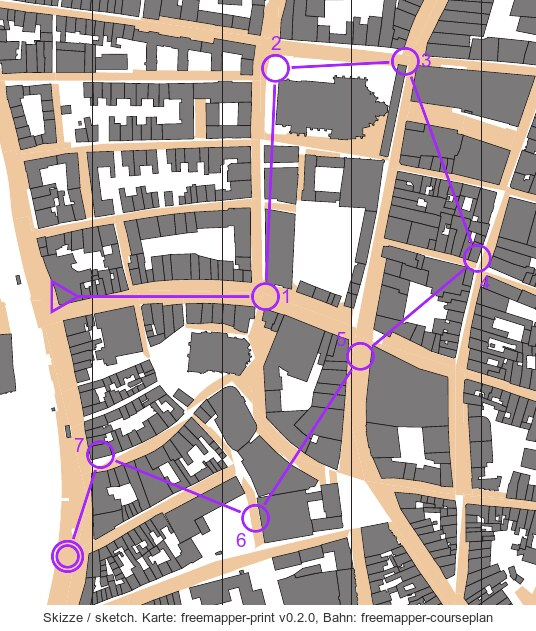

# Beispielveranstaltungen

[English](README.en.md)

Fertige Veranstaltungen auf Karten aus den
[Beispielen von freemapper](https://github.com/HenryJobst/freemapper/tree/main/examples). Zu jeder gehören die
Projektdatei, die Befehle, mit denen sie entstand, und ein Vorschaubild. Das Lübecker Beispiel hat in einer zweiten Projektdatei auch eine Score-Bahn. Dazu gehört die Ausgabe von `check`. Der Export nach IOF-XML 3.0
liegt als `course-data.xml` bei; er ist gegen das IOF-Schema geprüft und wird vom IOF-Leser von freemapper-course wieder eingelesen und trägt Breite und Länge. Ein Import in OE ist nicht getestet. Der Export nach Purple Pen liegt als `luebeck-sprint.ppen` bei; ein Test liest ihn mit dem Leser von freemapper-course wieder ein. Purple Pen 4.0 öffnet ihn ohne Fehler. Das Druck-PDF von freemapper-print kommt später dazu.

| Beispiel | Karte | Vorschau |
|---|---|---|
| [Sprinttraining Lübecker Altstadt](luebeck-sprint/) | Lübeck, 1:4000 |  |
