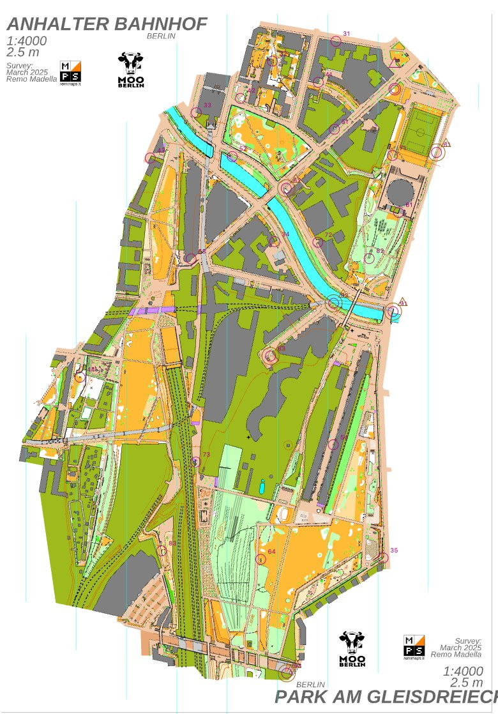

# Score course, Gleisdreieck

[Deutsch](README.md) · [All examples](../README.en.md)

<p align="center"><a href="../../docs/manual/images/gleisdreieck-course.jpg"></a><br><sub>The course in the editor; start and finish at the top right, 60 m apart. Map: Remo Madella, MOO Challenge Berlin 2025.</sub></p>

A score course with a 34-minute time limit on the map "Gleisdreieck" by Remo Madella (MOO Challenge Berlin 2025,
1:4000, 297 by 441 map millimetres, about 1.2 by 1.8 km). The course has 33 controls worth 95 points. It was set with
the command line only, and the controls come from `score draft`. The map sits here as `gleisdreieck.omap`. Remo
Madella released it on 2026-11-12 for use within the freemapper suite; that is not an open licence. The details are in
[`ATTRIBUTION.txt`](ATTRIBUTION.txt) and below. The picture is a capture of the editor; a printed PDF from freemapper-print
will follow. You can see the course on the map in the editor (`freemapper-courseplan edit gleisdreieck-score.courseplan.toml`).

**The program cannot reach 45 minutes, the usual size for adults, on this map.** See "Why 34 and not 45 minutes". At 34 minutes the good runner is near the target, not inside the band; see "Numbers".

## Files

- `gleisdreieck.omap`: the map, with `ATTRIBUTION.txt` naming the author and the permission
- `gleisdreieck-score.courseplan.toml`: the project file
- `transcript.de.txt`, `transcript.en.txt`: the commands and their output
- `check.de.txt`, `check.en.txt`: the check of the course, with four accepted warnings
- `course-data.xml`: the course as IOF XML 3.0
- `score-34.csv`, `score-34.sheet.de.md`, `score-34.sheet.md`: control list and evaluation sheet

## How it was made

```sh
freemapper-courseplan init gleisdreieck.omap --project gleisdreieck-score.courseplan.toml --title "Score course Gleisdreieck"
freemapper-courseplan special add gleisdreieck-score.courseplan.toml --kind start --id S-score --at 100,-290
freemapper-courseplan special add gleisdreieck-score.courseplan.toml --kind finish --id F-score --at 100,-275
freemapper-courseplan score suggest gleisdreieck-score.courseplan.toml --start S-score --finish F-score --limit 8
freemapper-courseplan score draft gleisdreieck-score.courseplan.toml "Score 34" --time-limit 34 --start S-score --finish F-score --apply
freemapper-courseplan score length gleisdreieck-score.courseplan.toml "Score 34"
freemapper-courseplan check gleisdreieck-score.courseplan.toml
freemapper-courseplan finding accept gleisdreieck-score.courseplan.toml wkb2026.score.code_ambiguity --controls 63,93 --note "..."
freemapper-courseplan export gleisdreieck-score.courseplan.toml --iof-xml course-data.xml
freemapper-courseplan export gleisdreieck-score.courseplan.toml --csv score-34.csv --course "Score 34"
freemapper-courseplan export gleisdreieck-score.courseplan.toml --sheet score-34.sheet.md --course "Score 34"
```

`map extent` gave an extent of -138.9 to 157.8 mm in x and -330.4 to 110.9 mm in y. Start and finish lie in the north of
the map, 15 mm (60 m) apart. The draft reached both; in a building or a blocked area it would stop with "cannot be
reached". Both lie on the mapped area, like all controls; `check` tests that since ADR 0084 (rule
`wkb2026.map.inside`). `map near` gives distances but does not say whether a point lies inside an area; look at both positions on
the map. `transcript.en.txt` has every command with its output.

## Numbers

| | |
|---|---|
| Controls, points | 33, 95 |
| Time limit | 34 minutes |
| Good runner | 90 of 95 points, 94.7 percent (band 87 to 93): near the target, 1.7 percentage points above the band |
| Very good runner | all 95 points, back after 96.3 percent of the limit (band 95 to 100): inside the band |
| Run time, release build, busy machine | `score suggest` about 2 s, `score draft` about 15 s, `score length` about 2 s |

The bands are targets with a tolerance of 3 percentage points (ADR 0083). The very good runner is inside the band and
the good runner 1.7 points above it, within the tolerance: near the target, no miss. `score draft` and `score length`
say so and exit with 0. A test (`gleisdreieck_score_example_reaches_its_targets_and_check_is_quiet`) keeps it that way.
I measured the run times on a machine that other processes loaded heavily (load about 30); an idle one is likely
faster.

`check` reports no error and four warnings: the codes 63 and 93, 61 and 91, 64 and 94, and 62 and 92 look alike when
turned upside down. With 33 controls almost all free codes are in use, so such pairs occur. The project file accepts the
four findings with a note on how far apart the two controls of a pair stand (about 470, 320, 520 and 530 m; the test
recomputes the distances). The limit of 34 minutes lies in the usual range of 30 to 90 minutes, so there is no limit
warning.

## Why 34 and not 45 minutes

I tried 45, 40, 35 and 30 minutes and every limit between 31 and 34, with the default settings and seed 1 and the start
in the north, as in the example. The result of the good and the very good runner:

| Limit | Good runner | Very good runner | State |
|---|---|---|---|
| 45 min | 100 percent of the points | back after 73.3 percent of the limit | missed |
| 40 min | 100 percent of the points | back after 82.5 percent | missed |
| 35 min | 98.9 percent of the points | no deviation named | missed, the good runner 5.9 points above the band |
| 34 min | 94.7 percent | back after 96.3 percent | near the target (good), inside the band (very good) |
| 33 min | 100 percent | no deviation named | missed, the draft reports that the free codes run out (best attempt 30 controls, 80 points) |
| 32 min | 95.3 percent | back after 96.4 percent | near the target |
| 31 min | 93.0 percent | back after 97.9 percent | inside the band |
| 30 min | 93.0 percent | back after 99.2 percent | inside the band |

So 34 minutes is the largest limit at which both runners are at least near the target. The largest with both inside
their bands is 31 minutes. From 35 minutes the good runner takes almost or all of the points, and at 40 and 45 minutes
the very good runner has plenty of time left; the closest attempt then has 33 controls worth 95 points, the most the
draft built here. I have not looked into why 33 minutes fail while 32 and 34 do not; the search is not exhaustive, and
the result can jump between neighbouring limits. I tried no other start, no other seed and no highest
value of 9 this time.

This is how the example got to its present state. A first version had 40 minutes, and the program delivered it; four of
its controls stood on the corners of a rectangle the map's author drew around the map content. That was a bug in the
program that this map brought to light: such a frame no longer yields control sites (ADR 0078). The second version had
33 minutes with both runners inside their bands. Six of its 27 controls stood in map areas with the symbol 520, "area
that shall not be entered", most of them on building outlines. `check` has reported that as an error since ADR 0081,
and since ADR 0082 `score suggest` and `score draft` no longer propose such sites. In addition the bands are targets
with a tolerance since ADR 0083. Together this brought the example to 34 minutes and 33 controls; I moved no control by
hand.

## Limits of this example

The routes come from a raster of the map symbols without elevation, and the runner paces (4:10 and 3:45 minutes per
kilometre) are a first version. The sites lie where the program found them. I did not look at each one on the map; look
at every position before you use the course. Many lie at building corners. Control 73 stands at a shifted place
(coordinates with many decimals); look at it with particular care. The IOF XML carries the time limit, penalty and
links in an extension element that has not been tried in OE. The file passes validation against the IOF schema
(`xmllint --noout --schema ../../tests/fixtures/iof-xml/IOF.xsd course-data.xml`); `createTime` is the time of the
run that made the file.

## Source and licence

Map and author are named in [`ATTRIBUTION.txt`](ATTRIBUTION.txt). **Remo Madella released the map for use within the
freemapper suite, not under an open licence.** If you want to use it outside the suite, ask him. The program and the
course data (project file, exports, outputs) are under GPL-3.0-or-later; the map content keeps its own situation.
Whether the permission also covers distributing the `.omap` in the public repository is not settled (ADR 0077).
