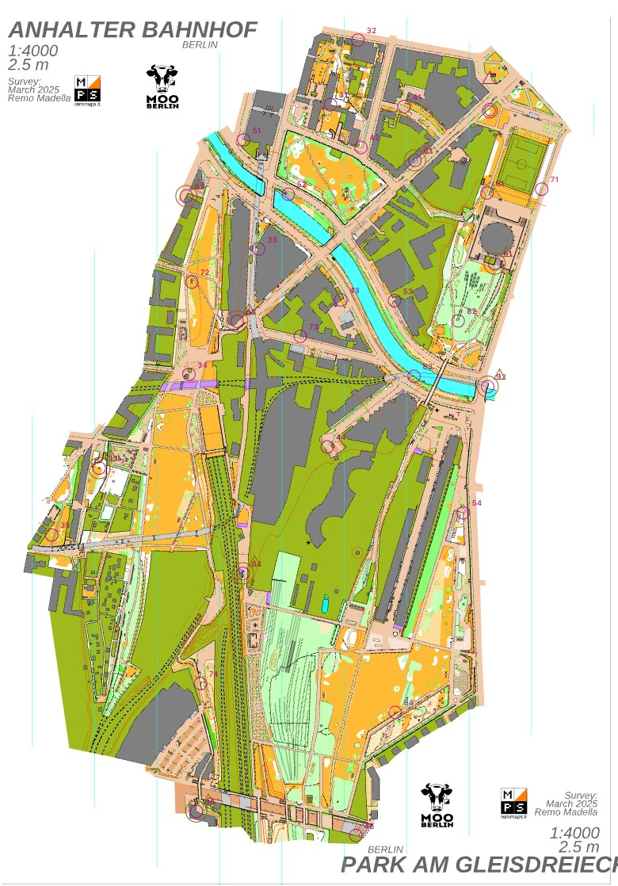

# Score-Bahn, Gleisdreieck

[English](README.en.md) · [Alle Beispiele](../README.md)

<p align="center"><a href="../../docs/manual/images/gleisdreieck-course.jpg"></a><br><sub>Die Bahn im Editor; Start und Ziel oben rechts, 60 m auseinander. Karte: Remo Madella, MOO Challenge Berlin 2025.</sub></p>

Eine Score-Bahn mit 31 Minuten Zeitlimit auf der Karte „Gleisdreieck“ von Remo Madella (MOO Challenge Berlin 2025,
1:4000, 297 mal 441 Kartenmillimeter, also etwa 1,2 mal 1,8 km). Die Bahn hat 30 Posten mit 80 Punkten. Sie wurde nur
mit der Kommandozeile gelegt, und die Posten stammen aus `score draft`. Die Karte liegt hier als `gleisdreieck.omap`.
Remo Madella hat sie am 12.11.2026 für die freemapper-Suite freigegeben; das ist keine offene Lizenz, Einzelheiten
stehen in [`ATTRIBUTION.txt`](ATTRIBUTION.txt) und unten. Das Bild ist eine Aufnahme des Editors; ein gedrucktes PDF von
freemapper-print folgt. Die Bahn auf der Karte siehst du im Editor (`freemapper-courseplan edit gleisdreieck-score.courseplan.toml`).

**45 Minuten, die übliche Größe für Erwachsene, schafft das Programm auf dieser Karte nicht.** Siehe „Warum 31 und nicht 45 Minuten“.

## Dateien

- `gleisdreieck.omap`: die Karte, mit `ATTRIBUTION.txt` für Urheber und Erlaubnis
- `gleisdreieck-score.courseplan.toml`: die Projektdatei
- `transcript.de.txt`, `transcript.en.txt`: die Befehle und ihre Ausgabe
- `check.de.txt`, `check.en.txt`: die Prüfung der Bahn, mit vier akzeptierten Warnungen
- `course-data.xml`: die Bahn als IOF-XML 3.0
- `score-31.csv`, `score-31.sheet.de.md`, `score-31.sheet.md`: Postenliste und Auswertungsbogen

## So ist es entstanden

```sh
freemapper-courseplan init gleisdreieck.omap --project gleisdreieck-score.courseplan.toml --title "Score-Bahn Gleisdreieck"
freemapper-courseplan special add gleisdreieck-score.courseplan.toml --kind start --id S-score --at 100,-290
freemapper-courseplan special add gleisdreieck-score.courseplan.toml --kind finish --id F-score --at 100,-275
freemapper-courseplan score suggest gleisdreieck-score.courseplan.toml --start S-score --finish F-score --limit 8
freemapper-courseplan score draft gleisdreieck-score.courseplan.toml "Score 31" --time-limit 31 --start S-score --finish F-score --apply
freemapper-courseplan score length gleisdreieck-score.courseplan.toml "Score 31"
freemapper-courseplan check gleisdreieck-score.courseplan.toml
freemapper-courseplan finding accept gleisdreieck-score.courseplan.toml wkb2026.score.code_ambiguity --controls 64,94 --note "..."
freemapper-courseplan export gleisdreieck-score.courseplan.toml --iof-xml course-data.xml
freemapper-courseplan export gleisdreieck-score.courseplan.toml --csv score-31.csv --course "Score 31"
freemapper-courseplan export gleisdreieck-score.courseplan.toml --sheet score-31.sheet.de.md --course "Score 31"
```

`map extent` ergab eine Ausdehnung von -138,9 bis 157,8 mm in x und -330,4 bis 110,9 mm in y. Start und Ziel liegen im
Norden der Karte, 15 mm (60 m) auseinander, also weit unter den 400 m, die erzeugte Bahnen einhalten (ADR 0086). Beide
sind mindestens 50 m vom Rand der kartierten Fläche entfernt, wie alle Posten (ADR 0087); das prüft `check`. Der Entwurf
hat beide erreicht; in einem Gebäude oder gesperrten Gebiet bräche er mit „nicht erreichbar“ ab. `map near` nennt
Abstände, sagt aber nicht, ob ein Punkt in einer Fläche liegt; sieh dir beide Positionen auf der Karte an.
`transcript.de.txt` hat jeden Befehl mit seiner Ausgabe.

## Zahlen

| | |
|---|---|
| Posten, Punkte | 30, 80 |
| Zeitlimit | 31 Minuten |
| Guter Läufer | 74 von 80 Punkten, 92,5 Prozent (Band 87 bis 93): im Band |
| Sehr guter Läufer | alle 80 Punkte, zurück nach 97,8 Prozent des Limits (Band 95 bis 100): im Band |
| Laufzeit, Release-Build, ausgelasteter Rechner | `score suggest` etwa 2 s, `score draft` etwa 9 s, `score length` etwa 1 s |

Beide Läufer liegen in ihren Bändern (ADR 0083), deshalb enden `score draft` und `score length` mit 0 und nennen keine
Abweichung. Ein Test (`gleisdreieck_score_example_reaches_its_targets_and_check_is_quiet`) hält es so. Die Laufzeiten
habe ich auf einem Rechner gemessen, den andere Prozesse stark auslasteten (Last etwa 40); auf einem ruhigen sind sie
eher kürzer.

`check` meldet keinen Fehler und vier Warnungen: Die Codes 64 und 94, 63 und 93, 62 und 92 sowie 61 und 91 sehen auf dem
Kopf gleich aus. Mit 30 Posten sind die meisten freien Codes vergeben, deshalb kommen solche Paare vor. Die
Projektdatei akzeptiert die vier Befunde mit dem Hinweis, wie weit die beiden Posten eines Paares auseinander stehen
(rund 470, 390, 690 und 250 m; der Test rechnet die Abstände nach). Kein Posten liegt tiefer als 60 m in einer Sackgasse
und keiner näher als 50 m am Rand der kartierten Fläche, zu diesen Regeln sagt `check` also nichts. Das Limit von 31
Minuten liegt im üblichen Bereich von 30 bis 90 Minuten, eine Limit-Warnung gibt es nicht.

## Warum 31 und nicht 45 Minuten

Ich habe 45, 40, 35 und 30 Minuten probiert und jedes Limit von 31 bis 34, mit den Standardeinstellungen, Startwert 1
und dem Start im Norden wie im Beispiel. Das Ergebnis für den guten und den sehr guten Läufer:

| Limit | Guter Läufer | Sehr guter Läufer | Zustand |
|---|---|---|---|
| 45 Min. | 100 Prozent der Punkte | zurück nach 71,8 Prozent des Limits | verfehlt |
| 40 Min. | 100 Prozent | zurück nach 80,8 Prozent | verfehlt |
| 35 Min. | 100 Prozent | keine Abweichung genannt | verfehlt |
| 34 Min. | 100 Prozent | keine Abweichung genannt | verfehlt |
| 33 Min. | 98,6 Prozent | keine Abweichung genannt | verfehlt |
| 32 Min. | 98,7 Prozent | zurück nach 90,7 Prozent | verfehlt |
| 31 Min. | 92,5 Prozent | zurück nach 97,8 Prozent | im Band (beide) |
| 30 Min. | 94,0 Prozent | zurück nach 95,1 Prozent | nahe am Ziel (gut), im Band (sehr gut) |

31 Minuten sind also das größte Limit, bei dem beide Läufer mindestens nahe am Ziel liegen, und beide liegen in ihren
Bändern. Ab 32 Minuten holt der gute Läufer fast alle oder alle Punkte. Darüber gehen die freien Codes aus: Der beste
Versuch hat 28 Posten mit 70 Punkten (bei 32 Minuten 29 Posten mit 75 Punkten), und der Entwurf sagt das. Die Suche ist
nicht erschöpfend, und das Ergebnis kann zwischen benachbarten Limits springen.

Die erste Fassung des Beispiels hatte 34 Minuten und 33 Posten. Drei neue Grenzen haben das
geändert (ADR 0085 bis 0087). Die Karte hat links der Flussbrücke einen Streifen am Kai entlang, eine Sackgasse von 208
m. Posten 54 der alten Fassung stand an ihrer Spitze, 208 m tief, wo der Läufer gar keine Routenwahl hat (ADR 0085
enthält die Messungen). Sechs weitere Posten standen zwischen 39 und 47 m vom Rand der kartierten Fläche, näher als die
50 m. Der Entwurf lässt solche Stellen jetzt aus, die Karte bietet also weniger Stellen, und der Coderaum ist bei 28 bis
30 Posten erschöpft. Das Ergebnis sind 31 Minuten mit 30 Posten. Ich habe keinen Posten von Hand verschoben.

## Grenzen dieses Beispiels

Die Routen kommen aus einem Raster der Kartensymbole ohne Höhe, und die Läuferpaces (4:10 und 3:45 Minuten je
Kilometer) sind eine erste Fassung. Die Stellen liegen dort, wo das Programm sie gefunden hat. Ich habe nicht jede auf
der Karte angesehen; sieh dir vor dem Einsatz jede Position an. Viele liegen an Gebäudeecken. Posten 63 steht auf einer
versetzten Stelle (Koordinaten mit vielen Nachkommastellen); sieh ihn dir besonders an. Das IOF-XML trägt Zeitlimit, Abzug und Verbindungen in einem
Erweiterungselement, das in OE nicht ausprobiert ist. Die Datei besteht die Prüfung gegen das IOF-Schema (`xmllint
--noout --schema ../../tests/fixtures/iof-xml/IOF.xsd course-data.xml`); `createTime` ist die Zeit des Laufs, der die
Datei erzeugt hat.

## Herkunft und Lizenz

Karte und Urheber stehen in [`ATTRIBUTION.txt`](ATTRIBUTION.txt). **Remo Madella hat die Karte für die
freemapper-Suite freigegeben, nicht unter einer offenen Lizenz.** Wer sie außerhalb der Suite nutzen will, fragt ihn.
Das Programm und die Bahndaten (Projektdatei, Exporte, Ausgaben) stehen unter GPL-3.0-or-later; der Karteninhalt
behält seine eigene Lage. Ob die Erlaubnis auch das Verteilen der `.omap` im öffentlichen Repository meint, ist nicht
geklärt (ADR 0077).
