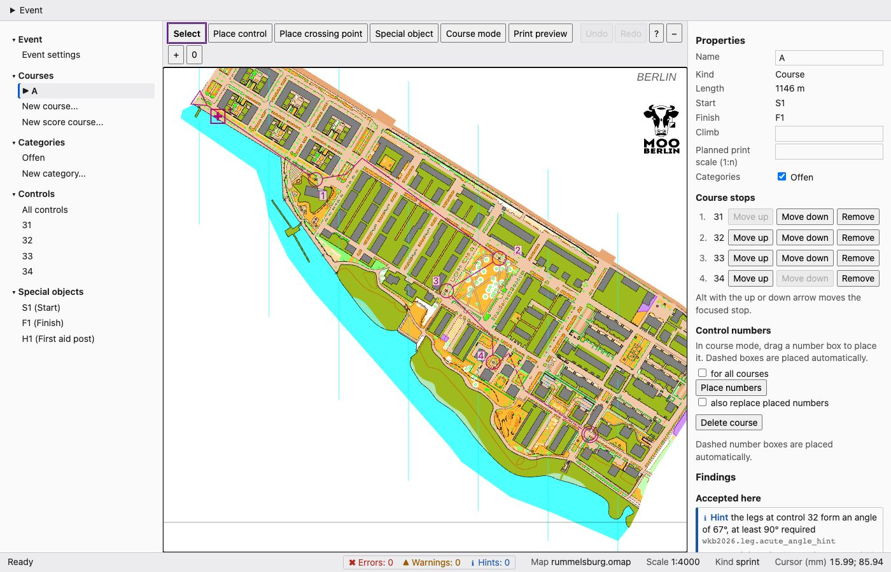

# Sprint training, Rummelsburger Bucht

[Deutsch](README.md) · [All examples](../README.en.md)

<p align="center"><a href="../../docs/manual/images/editor-overview-en.jpg"></a><br><sub>The course in the editor, start and finish in the park. Map: Remo Madella, MOO Challenge Berlin 2025.</sub></p>

A sprint course with four controls on the map "Rummelsburger Bucht" by Remo Madella (MOO Challenge Berlin 2025,
1:4000, 308 by 257 map millimetres, about 1.2 by 1.0 km). It was set with the command line only. The map sits
here as `rummelsburg.omap`. Remo Madella released it on 2026-11-12 for use within the freemapper suite; that is not
an open licence. The details are in [`ATTRIBUTION.txt`](ATTRIBUTION.txt) and below.

The picture is a capture of the editor; a printed PDF from freemapper-print will follow once it can print courses from
a `.ppen`. You can see the map in the editor itself (`freemapper-courseplan edit rummelsburg-sprint.courseplan.toml`).

## Files

- `rummelsburg.omap`: the map, with `ATTRIBUTION.txt` naming the author and the permission
- `rummelsburg-sprint.courseplan.toml`: the project file
- `transcript.de.txt`, `transcript.en.txt`: the commands and their output
- `check.de.txt`, `check.en.txt`: the check of the course, with no findings
- `course-data.xml`: the course as IOF XML 3.0, made with `export`
- `rummelsburg-sprint.ppen`: the course as a Purple Pen event, made with `export --ppen`

## How the course was made

```text
$ freemapper-courseplan init rummelsburg.omap --project rummelsburg-sprint.courseplan.toml --title "Sprint training Rummelsburger Bucht"
$ freemapper-courseplan special add rummelsburg-sprint.courseplan.toml --kind start --id S1 --at 3,0
$ freemapper-courseplan special add rummelsburg-sprint.courseplan.toml --kind finish --id F1 --at 10,5
$ freemapper-courseplan special add rummelsburg-sprint.courseplan.toml --kind first-aid --id H1 --at -4,-1
$ freemapper-courseplan control add rummelsburg-sprint.courseplan.toml --at 6.42,37.92
$ freemapper-courseplan control add rummelsburg-sprint.courseplan.toml --at 23.39,76.2
$ freemapper-courseplan control add rummelsburg-sprint.courseplan.toml --at 60.73,73.78
$ freemapper-courseplan control add rummelsburg-sprint.courseplan.toml --at 67.69,27.2
$ freemapper-courseplan class add rummelsburg-sprint.courseplan.toml Open
$ freemapper-courseplan course add rummelsburg-sprint.courseplan.toml A --start S1 --finish F1 --controls 31,32,33,34 --classes Open
$ freemapper-courseplan course numbers rummelsburg-sprint.courseplan.toml A
$ freemapper-courseplan info rummelsburg-sprint.courseplan.toml
course A: 4 controls, 0.9 km, climb – m
```

The coordinates are map millimetres, y pointing down. `map extent` gives the extent of the map, -154.9 to 153.0 mm
in x and -126.6 to 130.2 mm in y. Every output is in [`transcript.en.txt`](transcript.en.txt). The project sets no
climb because I measured none; `info` then shows a dash.

## Start and finish

Start `S1` and finish `F1` stand in the park in the middle of the map, 34 m apart: a start and finish area as you
would set it up at a sprint, easy to reach and easy to find, with the big tree (symbol 417) next to it. Both lie on the
mapped area, not inside a building and not inside an out-of-bounds area. That matters, because the map is a diagonal
strip and the blank part of the sheet beside it still lies inside the rectangle around all map objects. An earlier
version of this example had its finish there, in the blank part, and `map_edge` said nothing. `check` now tests start,
finish and controls against the map objects themselves (rule `wkb2026.map.inside`, ADR 0084).

## Straight legs

Every leg is the straight line from control to control, without bends. Bends are the exception: you set them only
when you want to steer a leg on purpose (see the manual, section "Legs and bends"), and a taped leg to the finish may
take a detour. This course needs neither.

Large parts of the map are buildings, water and areas that must not be entered (symbol 520), with narrow lanes
between them. The straight line between two controls therefore mostly runs over such areas. That is intended: the
runner goes around, and this choice between lanes and squares is the route choice of the course. `check` reports
nothing about it, because the line between two controls is not the running route (ADR 0080).

The controls stand at prominent map objects outside closed areas, each at least 0.8 mm from buildings, water and
closed areas: 31 and 33 at rings (symbol 530), 32 and 34 at monuments (526). None of them has an identical object
inside its circle. The legs are 152 m (start to 31), 167 m, 150 m, 188 m and 247 m (34 to the finish) long, 905 m of
straight line in all. The course runs once around the park and ends where it began. I looked for the sites with a
small script that works on the outlines of the map, and I did not look at each one on the map. Look at every control in
the editor before you use the course.

## Checking

`check` finds nothing on this course: `0 errors, 0 warnings, 0 hints; 0 accepted, 6 skipped`. All angles at the
controls lie between 102° and 161°. Of the six skipped rules, four are the length and difficulty rules of a
competition, which do not apply at a training. The fifth is the start capacity, because the event has no start
window, and the sixth is the rule that the best running route must not lead through an out-of-bounds area: it needs
a route analysis, which the program does not have yet. All commands and the output of `check --all` are in
[`check.de.txt`](check.de.txt) and [`check.en.txt`](check.en.txt).

## Special objects

Besides start and finish the project has a first aid post `H1` in the start and finish area. The course has no marked leg.

## Export to IOF XML

```text
$ freemapper-courseplan export rummelsburg-sprint.courseplan.toml --iof-xml course-data.xml
```

The file passes validation against the IOF schema (`xmllint --noout --schema ../../tests/fixtures/iof-xml/IOF.xsd
course-data.xml`). The map is georeferenced, so start, controls and finish carry latitude and longitude. `createTime`
is the time of the run that made the file; a new run changes only that line. An import into OE, Purple Pen or Condes
has not been tried, because nobody on the project has OE. If you do, report what arrives.

## Export to Purple Pen

```text
$ freemapper-courseplan export rummelsburg-sprint.courseplan.toml --ppen rummelsburg-sprint.ppen
```

The file does not exist yet, so `export` writes it new and records it in the project as `sources.ppen`. **This file
has not been opened in Purple Pen yet.** An export of an earlier example (the Lübeck old town) opened in Purple Pen
4.0 without errors; the writer is the same. If you have Purple Pen 4.0, open the file and report whether it loads and
whether controls, course and numbers sit in the right place.

## A score course on this map

The map is small for a score course. With start `S1` and finish `F1` a draft succeeds at 10 minutes (9 controls,
25 points; the good runner takes 23 of them, 92.0 percent, the very good runner all of them and finishes after 95.5
percent of the limit) and at 11 minutes (12 controls, 34 points, 91.2 and 95.4 percent). At 12 minutes (14 controls,
24 points) the good runner scores 95.8 percent and the very good runner finishes after 94.3 percent of the limit, both
just outside the bands but within the tolerance (ADR 0083). From 13 minutes the sites run out: the very good runner is
back after 91.3 percent of the limit instead of 95 to 100, at 15 minutes after 79.1, at 20 after 59.4, at 30 after
39.6 and at 45 after 26.4 percent; the closest attempt has 16 controls worth 28 points. Sites keep 50 m from the edge
of the mapped area since ADR 0087, which leaves less of this narrow strip: before, 16 minutes worked and 17 were near
the target. The frame around the sheet gives no sites any more (ADR 0078, ADR 0084). For longer courses use
[`../gleisdreieck/`](../gleisdreieck/), the larger map. These were runs of `score draft` without `--apply`; the
project here holds no score course.

## Source and licence

Map and author are named in [`ATTRIBUTION.txt`](ATTRIBUTION.txt). **Remo Madella released the map for use within the
freemapper suite, not under an open licence.** If you want to use it outside the suite, ask him. The program and the
course data (project file, exports, outputs) are under GPL-3.0-or-later; the map content keeps its own situation.
Whether the permission also covers distributing the `.omap` in the public repository is not settled (ADR 0077).
