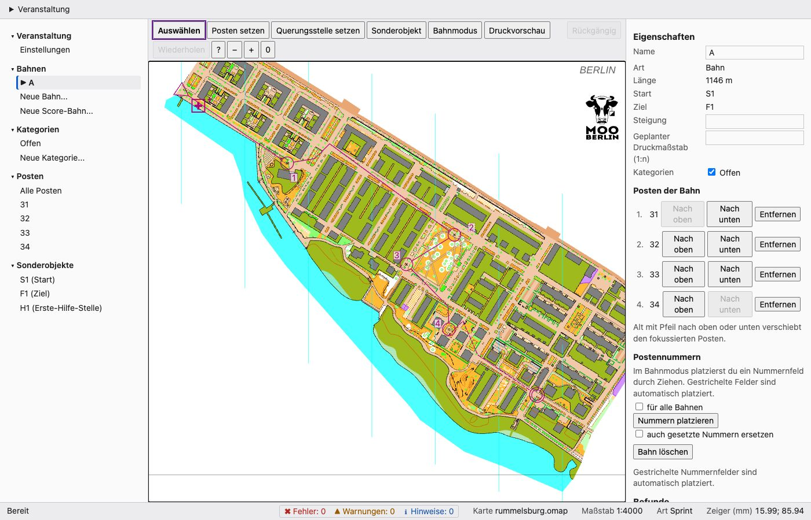

# Sprinttraining Rummelsburger Bucht

[English](README.en.md) · [Alle Beispiele](../README.md)

<p align="center"><a href="../../docs/manual/images/editor-overview-de.jpg"></a><br><sub>Die Bahn im Editor, Start und Ziel im Park. Karte: Remo Madella, MOO Challenge Berlin 2025.</sub></p>

Eine Sprintbahn mit vier Posten auf der Karte „Rummelsburger Bucht“ von Remo Madella (MOO Challenge Berlin 2025,
1:4000, 308 mal 257 Kartenmillimeter, also etwa 1,2 mal 1,0 km). Gelegt wurde sie nur mit der Kommandozeile.
Die Karte liegt hier als `rummelsburg.omap`. Remo Madella hat sie am 12.11.2026 für die freemapper-Suite
freigegeben; das ist keine offene Lizenz, Einzelheiten stehen in [`ATTRIBUTION.txt`](ATTRIBUTION.txt) und unten.

Das Bild ist eine Aufnahme des Editors; ein gedrucktes PDF von freemapper-print folgt, sobald es Bahnen aus einer
`.ppen` drucken kann. Die Karte siehst du im Editor selbst (`freemapper-courseplan edit rummelsburg-sprint.courseplan.toml`).

## Dateien

- `rummelsburg.omap`: die Karte, dazu `ATTRIBUTION.txt` mit Urheber und Erlaubnis
- `rummelsburg-sprint.courseplan.toml`: die Projektdatei
- `transcript.de.txt`, `transcript.en.txt`: die Befehle und ihre Ausgaben
- `check.de.txt`, `check.en.txt`: die Prüfung der Bahn, ohne Befunde
- `course-data.xml`: die Bahn als IOF-XML 3.0, erzeugt mit `export`
- `rummelsburg-sprint.ppen`: die Bahn als Purple-Pen-Event, erzeugt mit `export --ppen`

## So entstand die Bahn

```text
$ freemapper-courseplan init rummelsburg.omap --project rummelsburg-sprint.courseplan.toml --title "Sprinttraining Rummelsburger Bucht"
$ freemapper-courseplan special add rummelsburg-sprint.courseplan.toml --kind start --id S1 --at 3,0
$ freemapper-courseplan special add rummelsburg-sprint.courseplan.toml --kind finish --id F1 --at 10,5
$ freemapper-courseplan special add rummelsburg-sprint.courseplan.toml --kind first-aid --id H1 --at -4,-1
$ freemapper-courseplan control add rummelsburg-sprint.courseplan.toml --at 6.42,37.92
$ freemapper-courseplan control add rummelsburg-sprint.courseplan.toml --at 23.39,76.2
$ freemapper-courseplan control add rummelsburg-sprint.courseplan.toml --at 60.73,73.78
$ freemapper-courseplan control add rummelsburg-sprint.courseplan.toml --at 67.69,27.2
$ freemapper-courseplan class add rummelsburg-sprint.courseplan.toml Offen
$ freemapper-courseplan course add rummelsburg-sprint.courseplan.toml A --start S1 --finish F1 --controls 31,32,33,34 --classes Offen
$ freemapper-courseplan course numbers rummelsburg-sprint.courseplan.toml A
$ freemapper-courseplan info rummelsburg-sprint.courseplan.toml
Bahn A: 4 Posten, 0,9 km, Anstieg – m
```

Die Koordinaten sind Kartenmillimeter, y zeigt nach unten. `map extent` nennt die Ausdehnung der Karte, -154,9 bis
153,0 mm in x und -126,6 bis 130,2 mm in y. Jede Ausgabe steht in [`transcript.de.txt`](transcript.de.txt). Das
Projekt setzt keinen Anstieg, weil ich keinen gemessen habe; `info` zeigt dann einen Strich.

## Start und Ziel

Start `S1` und Ziel `F1` stehen im Park in der Mitte der Karte, 34 m auseinander: ein Start- und Zielbereich, wie man
ihn bei einem Sprint ausrichtet, gut zu erreichen und mit dem großen Baum (Symbol 417) daneben leicht zu finden. Beide
liegen auf der kartierten Fläche, nicht in einem Gebäude und nicht in einer gesperrten Fläche. Das ist keine
Kleinigkeit, denn die Karte ist ein schräger Streifen, und der weiße Teil des Blatts daneben liegt noch im Rechteck um alle
Kartenobjekte. Eine frühere Fassung dieses Beispiels hatte das Ziel dort, im weißen Teil, und `map_edge` meldete
nichts. `check` prüft Start, Ziel und Posten seitdem gegen die Kartenobjekte selbst (Regel `wkb2026.map.inside`,
ADR 0084).

## Gerade Strecken

Jede Strecke ist die gerade Linie von Posten zu Posten, ohne Knickpunkte. Knickpunkte sind die Ausnahme: Du setzt
sie nur, wenn du eine Strecke bewusst führen willst (siehe das Handbuch, Abschnitt „Strecken und Knicke“), und
eine markierte Strecke ins Ziel darf einen Umweg haben. Diese Bahn braucht beides nicht.

Die Karte besteht zu großen Teilen aus Gebäuden, Wasser und Flächen, die man nicht betreten darf (Symbol 520), mit
schmalen Gassen dazwischen. Die Luftlinie zwischen zwei Posten läuft deshalb meist über solche Flächen. Das ist
gewollt: Der Läufer geht drumherum, und diese Wahl zwischen Gassen und Plätzen ist die Routenwahl der Bahn. `check`
meldet dazu nichts, denn die Linie zwischen zwei Posten ist nicht die Laufroute (ADR 0080).

Die Posten stehen an hervorgehobenen Kartenobjekten außerhalb gesperrter Flächen, jeweils mindestens 0,8 mm von
Gebäuden, Wasser und gesperrten Flächen entfernt: 31 und 33 an Ringen (Symbol 530), 32 und 34 an Denkmälern (526).
Keiner der Posten hat ein gleiches Objekt in seinem Kreis. Die Strecken sind 152 m (Start bis 31), 167 m, 150 m, 188 m
und 247 m (34 bis Ziel) lang, zusammen 905 m Luftlinie. Die Bahn läuft einmal im Kreis um den Park und kommt dort
wieder an. Ich habe die Stellen mit einem
kleinen Skript gesucht, das auf den Umrissen der Karte rechnet, und sie nicht jede auf der Karte angesehen. Sieh dir jeden Posten im Editor an, bevor du die Bahn benutzt.

## Prüfen

`check` findet bei dieser Bahn nichts: `0 Fehler, 0 Warnungen, 0 Hinweise; 0 akzeptiert, 6 übersprungen`. Alle
Winkel an den Posten liegen zwischen 102° und 161°. Von den sechs übersprungenen Prüfregeln sind vier Längen- und
Schwierigkeitsregeln des Wettkampfs, die beim Training nicht gelten. Die fünfte ist die Startkapazität, weil die
Veranstaltung kein Startfenster hat, die sechste die Regel, dass die beste Laufroute nicht durch ein Sperrgebiet führen
darf: Sie braucht eine Routenanalyse, die das Programm noch nicht hat. Alle Befehle und die Ausgabe von `check --all`
stehen in [`check.de.txt`](check.de.txt) und [`check.en.txt`](check.en.txt).

## Sonderobjekte

Außer Start und Ziel hat das Projekt einen Erste-Hilfe-Posten `H1` im Start- und Zielbereich. Die Bahn hat keine markierte
Strecke.

## Export nach IOF-XML

```text
$ freemapper-courseplan export rummelsburg-sprint.courseplan.toml --iof-xml course-data.xml
```

Die Datei besteht die Prüfung gegen das IOF-Schema (`xmllint --noout --schema ../../tests/fixtures/iof-xml/IOF.xsd
course-data.xml`). Die Karte ist georeferenziert, deshalb tragen Start, Posten und Ziel Breite und Länge. `createTime`
ist die Zeit des Laufs, der die Datei erzeugt hat; ein neuer Lauf ändert nur diese Zeile. Ein Import in OE, Purple Pen oder Condes ist nicht getestet, weil im Projekt niemand OE hat. Wer es tut, soll melden, was
ankommt.

## Export nach Purple Pen

```text
$ freemapper-courseplan export rummelsburg-sprint.courseplan.toml --ppen rummelsburg-sprint.ppen
```

Die Datei gibt es noch nicht, deshalb schreibt `export` sie neu und trägt sie im Projekt als `sources.ppen` ein. **Diese
Datei ist in Purple Pen noch nicht geöffnet worden.** Ein Export eines früheren Beispiels (Lübecker Altstadt) hat
Purple Pen 4.0 ohne Fehler geöffnet; der Schreiber ist derselbe. Wer Purple Pen 4.0 hat, soll die Datei öffnen und
melden, ob sich alles laden lässt und ob Posten, Bahn und Nummern an der richtigen Stelle stehen.

## Score-Bahn auf dieser Karte

Die Karte ist für eine Score-Bahn klein. Mit Start `S1` und Ziel `F1` gelingt ein Entwurf mit 15 Minuten (12 Posten,
28 Punkte; der gute Läufer holt 26 davon, 92,9 Prozent, der sehr gute alle und ist nach 99,1 Prozent des Limits im
Ziel) und mit 16 Minuten (14 Posten, 40 Punkte, 92,5 und 97,6 Prozent). Bei 17 Minuten liegt der gute Läufer mit 93,8
Prozent knapp über dem Band, noch innerhalb der Toleranz (ADR 0083). Ab 18 Minuten reichen die Stellen nicht: Der sehr
gute Läufer ist nach 90,4 Prozent des Limits im Ziel statt nach 95 bis 100, bei 20 Minuten nach 81,3, bei 30 nach 54,2
und bei 45 nach 36,2 Prozent. Der Rahmen um das Blatt liefert keine Stellen mehr (ADR 0078, ADR 0084); eine frühere
Fassung dieser Zahlen hatte Posten in den Ecken des Rahmens. Für längere Bahnen nimm [`../gleisdreieck/`](../gleisdreieck/),
die größere Karte. Das sind Läufe mit `score draft` ohne `--apply`; das Projekt hier enthält keine Score-Bahn.

## Herkunft und Lizenz

Karte und Urheber stehen in [`ATTRIBUTION.txt`](ATTRIBUTION.txt). **Remo Madella hat die Karte für die
freemapper-Suite freigegeben, nicht unter einer offenen Lizenz.** Wer sie außerhalb der Suite nutzen will, fragt ihn.
Das Programm und die Bahndaten (Projektdatei, Exporte, Ausgaben) stehen unter GPL-3.0-or-later; der Karteninhalt
behält seine eigene Lage. Ob die Erlaubnis auch das Verteilen der `.omap` im öffentlichen Repository meint, ist nicht
geklärt (ADR 0077).
